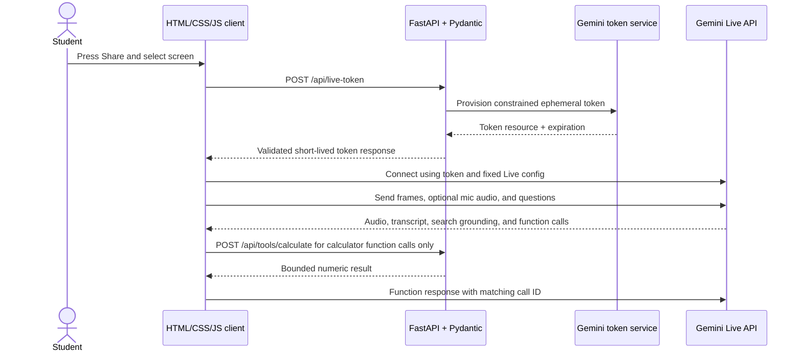

# Backend Design

**Project:** Screen Tutor
**Status:** Backend API contract and implementation
**Service:** Python and Pydantic

## Purpose and scope

The backend exists to protect the long-lived Gemini API key and issue short-lived Gemini Live credentials to the browser. The browser connects directly to the Gemini Live API so real-time screen and audio streams do not pass through or get stored by Screen Tutor's server. The server fixes the Live model's approved tool set and provides the bounded calculator function endpoint; Google Search runs as Gemini's built-in grounding tool.

For the MVP, the backend does not receive screen frames, microphone audio, tutor audio, transcripts, or annotation data. It does not proxy the Live WebSocket.

The backend also runs the **class library**: it stores each student's classes and uploaded course materials (notes, documents, syllabi, lecture slides, and video/audio lectures), extracts text and transcribes lectures with the Gemini API, and generates quizzes, practice tests, study guides, and flashcards from them. This part uses Supabase Auth for sign-in, Supabase PostgreSQL for application data and Auth sessions, and private file storage.

## Backend stack

- Python 3.12+
- FastAPI for a small HTTP API and serving the built frontend on the same origin.
- Pydantic v2 for request, settings, and response validation.
- `pydantic-settings` for environment-based configuration, including local `.env` loading.
- Google's `google-genai` Python SDK to provision ephemeral Live API tokens.
- SymPy for exact numeric arithmetic and bounded symbolic simplification; user expressions are converted from a small Python AST allowlist rather than passed to SymPy's string parser.
- Uvicorn as the ASGI server.
- Supabase Auth and its managed PostgreSQL database. Supabase Auth owns login sessions; the app schema stores class-library data and refers to the Supabase Auth user ID for ownership. Schema changes live in timestamped files under `supabase/migrations/`.
- Private local file storage for the single-instance hackathon backend (`backend/.local/private_uploads` by default), with short-lived signed download URLs. Deployments on ephemeral hosts need a persistent private volume or a private object-storage adapter.
- In-process FastAPI `BackgroundTasks` for slow upload and generation work in this hackathon build. Jobs are not durable across restarts; use a persistent queue such as RQ or Celery before multi-instance or production deployment.
- File parsers: `pypdf` for PDFs, `python-docx` for DOCX, `python-pptx` for PPTX. Images, scanned PDFs, and video/audio go to Gemini.

### Supabase PostgreSQL schema

The migrations cover Supabase Auth user ownership, classes, course notes/materials, generated quizzes and practice exams (as well as the other study-material types), source-note links, completed attempts, and student error flags. Class `owner_id` references `auth.users(id)` directly with `ON DELETE CASCADE`; the app does not keep a duplicate user identity table. Foreign keys cascade class deletion through its notes, generated materials, and attempts. Composite class keys prevent source-note link rows from crossing class boundaries; backend validation also checks citations inside generated JSON. Deleting a source note removes generated materials derived from it. PostgreSQL holds private storage keys, extracted text, lecture transcript segments, and syllabus outlines. Original files live outside the static web root. Live screen/audio media, live-session transcripts, annotation events, and tutoring conversations are not stored.

### Supabase Auth sessions

Supabase Auth is the source of truth for browser sign-in sessions. It stores and manages those records in its protected `auth.sessions` table and issues a short-lived access-token JWT plus a rotating refresh token. Do not create a second `public.user_sessions` table, copy refresh tokens into application tables, or write directly to `auth.sessions`; use the Supabase Auth client/API for sign-in, refresh, and sign-out. The app schema only references the stable Supabase user UUID (`auth.users.id`) for ownership.

| Event | Session behavior |
| --- | --- |
| Sign-in | Supabase Auth creates the login session and returns access and refresh tokens to the browser Auth client. |
| API request | The browser sends the current access JWT to FastAPI; FastAPI verifies it and uses the verified `sub` UUID as the owner. |
| Token refresh | The Auth client exchanges the current refresh token for a new access/refresh pair; application tables are not involved. |
| Sign-out | The Auth client asks Supabase Auth to revoke the session and clears its local session state. An already-issued access JWT can remain valid until its `exp` claim. |

The browser uses the Supabase JavaScript Auth client to sign in and refresh its session. For every protected FastAPI request, it sends the current access token as `Authorization: Bearer <access-token>`. FastAPI verifies the JWT signature and validates its issuer, audience, expiration, and `sub` claim using the project's Supabase signing keys or a supported Supabase verifier. It treats the verified `sub` UUID as the caller identity; it never trusts a user ID sent in a request body or URL. The frontend's publishable key is safe for browser use; Supabase secret/service-role keys and the PostgreSQL connection string remain server-only.

The Supabase Auth project settings control access-token lifetime and supported session timeouts. Access tokens default to a one-hour lifetime; sessions otherwise remain active until sign-out or another configured termination event. Keep the default JWT lifetime unless deployment needs justify a change, and choose session timeout settings before public deployment. If a future high-risk operation requires immediate session revocation, additionally check the token's `session_id` against Supabase Auth session state for that operation; do not make every request depend on querying internal Auth tables.

Application tables have row-level security enabled with no browser-facing policies in the prototype. Class-library data is accessed through FastAPI, which verifies the caller and scopes every query by the verified owner UUID. Keep the database connection and any privileged Supabase key on the server. If the app later accesses application tables directly through Supabase's Data API, add and review user-scoped RLS policies before granting that access.

Keep schema changes in timestamped `supabase/migrations/` files and apply them through the Supabase CLI. Obtain `DATABASE_URL` from the Supabase project's Connect dialog and store it only on the server. A persistent backend can use the direct connection where its network supports IPv6 (or the project's IPv4 add-on); an IPv4-only backend can use the session pooler. Use the project's selected Postgres major version when configuring local Supabase development.

This login session is separate from a tutoring Live session. The browser owns the Gemini Live connection and any transient resume handle. Do not store Gemini ephemeral access tokens, Live session handles, media, transcripts, annotations, or tutoring conversations in Supabase Auth or the application tables.

The frontend can be plain HTML/CSS/JS bundled by Vite. In development, Vite proxies `/api` to FastAPI; in deployment, FastAPI serves the built static files or the host serves both behind one same-origin URL.

## Responsibilities

### Backend owns

- Load and validate `GEMINI_API_KEY` and the server-selected `GEMINI_MODEL`.
- Verify Supabase Auth access tokens and derive the caller's user ID from verified claims.
- Create ephemeral tokens with short session-start and token expiration windows.
- Lock token constraints to the approved Live model and the app's fixed session configuration, Google Search grounding, and function declarations where supported by the API.
- Execute only the bounded `calculate_expression` function through the calculator endpoint; the browser handles Live tool calls and annotation rendering.
- Apply request-size limits, origin checks, rate limits, and sanitized errors.
- Serve the frontend and a health endpoint, if the selected deployment uses a same-origin host.
- Supabase Auth sign-in/session management, and scoping every class, upload, and study material to the verified owner's Supabase user ID.
- Receiving course-material uploads, validating type and size, and storing the original file.
- Extracting text from documents and slides, transcribing video/audio lectures with timestamps, and parsing syllabi into a topic/exam outline.
- Generating quizzes, practice tests, study guides, and flashcards from a class's materials with a structured-output schema, and validating the result before saving it.
- Scoring quiz and practice-test attempts.
- Adding the selected class's materials (or a summary of them) to the Live session's system instructions when issuing a token for that class.

### Backend does not own

- Browser screen selection or media capture.
- Live audio/video forwarding, model response playback, or annotation rendering.
- General purpose model proxying, screenshot persistence, or Live conversation storage.
- Any tool that clicks, types, or controls the student's desktop.

## Request flow



The server token request occurs after the student begins the session. It is independent of the media stream. The browser sends media directly to Gemini and handles all Live events.

## HTTP API

### Frontend integration status

The frontend on `main` was reviewed after pulling commit `92b3691`. Its current HTTP client in [`frontend/src/api.js`](../frontend/src/api.js) only calls `POST /api/live-token`, sends `{}`, and does not attach a Supabase access token. The class page still reads and writes starter classes in `localStorage` ([`frontend/src/classes.js`](../frontend/src/classes.js)); the library adds file metadata locally without uploading file bytes ([`frontend/src/library.js`](../frontend/src/library.js)); and the study page creates placeholder materials locally ([`frontend/src/study.js`](../frontend/src/study.js)). The quiz and flashcard views are placeholders. The backend routes below are implemented, but the frontend screens do not yet consume them.

The backend implements `GET /healthz`, `POST /api/live-token`, `POST /api/tools/calculate`, and the class-library routes below. With `SUPABASE_URL` configured, it verifies Supabase access-token signatures and claims and requires the verified user for API calls. Without Supabase configured, the standalone token and calculator prototype requires `DEMO_GATE_TOKEN`; protected requests return `503` if neither authentication option is configured. Class-library routes remain unavailable without Supabase Auth, PostgreSQL, and private storage.

Before protected API calls can work, the frontend must initialize Supabase Auth and send `Authorization: Bearer <current-access-token>` on each `/api/*` request. Supabase Auth itself owns sign-in, refresh, and sign-out; FastAPI does not add duplicate auth-session endpoints. The tutor screen must also pass its selected `class_id` to `/api/live-token` if the model should receive class materials.

The pulled `frontend/src/gemini-live.js` currently handles annotation requests locally, but it does not execute `calculate_expression` through `/api/tools/calculate` or send function responses back to Gemini. The class tutor currently starts the same empty token request as Quick tutor. The frontend integration must route approved calculator calls to the calculator endpoint, answer every custom Live function call using its matching call ID, and supply the selected class ID for class tutoring. `google_search` stays inside Gemini and `add_annotations` stays local to the browser.

### Shared API conventions

- Use same-origin `/api` requests and JSON unless the endpoint is a file upload.
- The API's CORS allow-list must permit `GET`, `POST`, `PATCH`, `PUT`, `DELETE`, and `OPTIONS` for the configured frontend origins; do not enable wildcard credentialed CORS.
- Class-library routes require a valid Supabase access token. Token and calculator routes use the same verified Supabase identity when configured, or the private demo gate when Supabase is not configured. `GET /healthz` is public. The short-lived signed file URL is a bearer link and does not require a Supabase header. FastAPI derives the owner from the verified JWT and checks ownership for every class, upload, and material ID. Never accept `owner_id` from the client.
- IDs are UUID strings. Enum values in requests and responses use lowercase `snake_case`; the frontend can map them to its title-case labels (for example, `lecture_video` → “Lecture”).
- Collection responses use `{"items": [...]}`. Mutations return the created or updated resource unless the contract says `204 No Content`.
- Errors use `{"code": "...", "message": "...", "request_id": "..."}`. Messages are safe to show to a student and do not include raw upstream errors or submitted file/text contents.
- Return `404` for both missing and non-owned resources so IDs cannot be used to discover another student's data.

### `POST /api/live-token`

When `SUPABASE_URL` is configured, this requires a valid Supabase access token in the `Authorization: Bearer <access-token>` header. In no-Supabase demo mode, the configured `DEMO_GATE_TOKEN` is required and `class_id` cannot be used. No caller-controlled model or tool configuration is accepted. The request body is empty (or `{}`), or contains only an optional `class_id`, so the server always chooses the model and configuration. When `class_id` is given, the server checks that the verified Supabase user owns the class and builds the session's system instructions from that class's materials on the server side; the client cannot supply its own instructions.

**Success response**

```json
{
  "access_token": "ephemeral-token-value",
  "model": "gemini-3.8-live",
  "expires_at": "2026-10-10T18:30:00Z"
}
```

`access_token` is the short-lived token resource returned by Google's token provisioning API. It is a bearer credential: return it only to the requesting app session, never log it, persist it, or send it to analytics. The browser passes it to the Google GenAI JavaScript SDK for a Live API session.

**Pydantic contracts**

- `LiveTokenRequest`: optional `class_id` only; reject unexpected fields so callers cannot select a different model or expand tool access.
- `LiveTokenResponse`: required `access_token`, literal/configured `model`, and timezone-aware `expires_at`.
- `ErrorResponse`: stable error code and short user-safe message; never include upstream credentials or raw exception text.

**Status codes**

| Status | Meaning |
| --- | --- |
| `200` | Token issued |
| `400` | Malformed request |
| `401` | App authentication required or expired |
| `403` | Request origin or policy rejected |
| `429` | Token issuance rate limit reached |
| `503` | Server is missing Gemini configuration |
| `502` | Gemini token provisioning failed |

### Approved Live tools

The backend creates one immutable tool set inside the server-owned `LiveConnectConfig` and locks it into the ephemeral token where supported:

| Tool | Type | Purpose and execution |
| --- | --- | --- |
| `google_search` | Gemini built-in grounding tool | Verify current or uncertain facts. Gemini performs the search and returns grounded response content and source metadata over the direct Live connection; there is no backend search proxy or search-results database. |
| `calculate_expression` | Blocking custom function declaration | Evaluate exact arithmetic or bounded symbolic expressions. The Live API sends the function call to the browser; the browser calls `POST /api/tools/calculate` and returns the API result to the same Live session using the original function-call ID and name. Gemini waits for the response before continuing. |
| `add_annotations` | Blocking custom function declaration | Request a temporary mark over the matching shared-screen frame. This remains the only visual action. The browser validates and renders the call over its in-page preview, then replies to the matching function call. Gemini waits for the response before continuing. |

The function-call declarations and their schemas are fixed by the backend. The caller cannot add tools, change descriptions or schemas, or send tool configuration with `/api/live-token`. Google Search grounding is for fact checking and current information; it does not grant general browsing, arbitrary URL fetching, or application control. The Live service performs Search internally. It does not send search queries or results through the Screen Tutor backend.

The frontend receives grounded answer parts and any grounding metadata directly from Gemini. A Live `serverContent` event may include `groundingMetadata`; accumulate its `groundingChunks` in order across the turn because later streamed metadata can contain only newly added chunks. Use `groundingSupports[].groundingChunkIndices` to associate supported text segments with their source chunks. Show source titles and links using the source URIs supplied by Gemini. Follow the API's grounding attribution requirements, including its Search Suggestions entry point when one is returned. If metadata is absent, do not invent citations from spoken text. Search metadata and citations remain in frontend session state only and are discarded when the tutoring session ends.

### `POST /api/tools/calculate`

This endpoint is the executor for the `calculate_expression` Live function. The browser calls it only after receiving that function call from Gemini, then sends the returned `result` object back through the same Live session. It accepts a JSON body with one expression and does not accept model names, tool declarations, or instructions.

**Request**

```json
{
  "expression": "factor(x**2 - 1)"
}
```

**Success response**

```json
{
  "result": "(x - 1)*(x + 1)"
}
```

The result is an exact numeric or symbolic string (up to 512 characters), so fractions and radicals do not lose precision through JavaScript floating-point conversion. Numeric literals are converted to exact SymPy rationals. The parser supports named symbols (up to 16), `pi`, `e`, parentheses, unary `+`/`-`, `+`, `-`, `*`, `/`, `//`, `%`, and powers using `**`. It supports `sqrt`, `sin`, `cos`, `tan`, `asin`, `acos`, `atan`, `sinh`, `cosh`, `tanh`, `exp`, `log`, `abs`, `simplify`, `factor`, and `expand`. Use `simplify(expression)`, `factor(expression)`, or `expand(expression)` for those explicit symbolic transformations; ordinary arithmetic remains exact. This provides symbolic expression manipulation, but does not solve equations or accept arbitrary SymPy/Python syntax.

Inputs are limited to 256 characters, 64 AST nodes, 32 AST levels, and 16 distinct symbols. Numeric literals and all-numeric intermediate results must be finite and within magnitudes `1e-100` through `1e100`, with zero allowed; numeric exponents are limited to absolute value 100. Results are capped at 128 operations and 512 characters. Function calls are accepted only when the function name is in the explicit allowlist, with no keyword arguments. Attribute access, imports, strings, containers, and all other Python syntax are rejected. The service constructs SymPy expressions from the validated AST; it does not pass user strings to SymPy's `parse_expr` or execute submitted code.

The request uses the same configured app authorization gate and allow-listed Origin check as token issuance. With Supabase configured, the gate is a verified access token; otherwise it is `DEMO_GATE_TOKEN`. It has a separate per-IP, per-process rate limit, with defaults in `.env.example`. The response never echoes the expression; the endpoint does not log or store expressions or results.

**Failure responses**

| Status | Meaning |
| --- | --- |
| `400` | Invalid syntax, unsupported expression, division by zero, or an expression limit was exceeded |
| `401` | App authentication required or expired |
| `403` | Request origin or policy rejected |
| `413` | Request body exceeds the configured limit (default 1,024 bytes) |
| `429` | Calculator rate limit reached |

Errors use the shared `{ "code", "message", "request_id" }` response shape. Calculator-specific codes are `invalid_expression` for a rejected expression and `calculator_rate_limited` for `429`; shared request codes include `invalid_request`, `request_too_large`, `authentication_required`, and `origin_not_allowed`.

Live reports custom calls in `toolCall.functionCalls[]`. Both custom functions are declared with `behavior: BLOCKING`, so Gemini waits for their responses. The browser should dispatch each call only by its approved name, then return the matching `functionResponses[]` with the original function-call ID and name. If one event contains several calls, return a response for each one in the same response message. Track call IDs so a cancellation event can stop an outstanding calculator fetch and prevent its late response from being sent. Never execute an unknown function name. For a failed calculator call, return only the sanitized `code` and `message` as a short structured function error so the tutor can ask for a clearer expression or explain the limit. If the HTTP request itself fails, use a generic `calculator_unavailable` error; do not retry in a loop. For success, return `{ "result": "37" }` as the function response. `google_search` is Gemini's built-in tool and does not use this custom function-call path. Live function calls are not executed automatically by the API; the client must execute and answer them.

The browser's execution outline is:

```javascript
const response = await fetch("/api/tools/calculate", {
  method: "POST",
  headers: {
    "Authorization": `Bearer ${appAccessToken}`,
    "Content-Type": "application/json",
  },
  body: JSON.stringify({ expression: functionCall.args.expression }),
});

const result = await response.json();
session.sendToolResponse({
  functionResponses: [{
    id: functionCall.id,
    name: functionCall.name,
    response: response.ok
      ? result
      : { error: { code: result.code, message: result.message } },
  }],
});
```

Use the application's current authorization token in the example above; do not use the Gemini ephemeral token for the Screen Tutor HTTP API. Check the function name against the approved set before executing it. Handle `add_annotations` locally and leave `google_search` execution to Gemini's built-in tool service.

### Class library endpoints

These routes provide the persistent data currently represented by frontend-local arrays. Class colors and initials are presentation details, not stored class data; the frontend derives them from the class name unless a later product decision makes them user-editable.

#### Classes

`ClassSummary` is:

```json
{
  "id": "9f66d1a2-4b9f-4ae2-bc26-38df0fb6b4dd",
  "name": "Math 151",
  "created_at": "2026-10-10T18:00:00Z",
  "updated_at": "2026-10-10T18:00:00Z",
  "upload_count": 3,
  "material_count": 2
}
```

| Method and path | Contract |
| --- | --- |
| `GET /api/classes` | Return `{"items": [ClassSummary, ...]}` for the caller, newest or recently updated first. Empty accounts return an empty array; do not seed the frontend's demo classes on the server. |
| `POST /api/classes` | Accept `{"name": "Math 151"}`; trim and validate a non-empty name up to `MAX_CLASS_NAME_LENGTH` characters (100 by default). Return `201` and the new `ClassSummary`. |
| `PATCH /api/classes/{class_id}` | Accept `{"name": "Math 152"}` and return the updated `ClassSummary`. Reject unknown fields. |
| `DELETE /api/classes/{class_id}` | Delete the class and cascade its database rows and private files. Return `204`. |

#### Uploads and course materials

`POST /api/classes/{class_id}/uploads` accepts `multipart/form-data`. For the current file picker, send one `file` and optional lowercase `kind` and `title` fields. If the paste-text UI is connected, send `text`, `title`, and optional `kind` instead of `file`; exactly one of `file` or `text` is allowed. A missing file `title` defaults to the original filename. The backend validates the extension, checks a file signature for supported binary formats, enforces the configured size limit regardless of client-side checks, writes original bytes to private storage, creates a note row, queues processing, and returns `202 Accepted`.

```json
{
  "id": "0ff95e83-aea8-4fe7-9d01-1f0c01afde01",
  "class_id": "9f66d1a2-4b9f-4ae2-bc26-38df0fb6b4dd",
  "title": "Week 3 notes.pdf",
  "kind": "notes",
  "source_type": "file",
  "original_filename": "Week 3 notes.pdf",
  "mime_type": "application/pdf",
  "file_size_bytes": 82731,
  "status": "processing",
  "processing_progress": 0,
  "failure_code": null,
  "created_at": "2026-10-10T18:04:00Z",
  "updated_at": "2026-10-10T18:04:00Z"
}
```

`kind` is one of `notes`, `document`, `syllabus`, `slides`, `lecture_video`, or `lecture_audio`. Map the frontend's displayed categories (“Notes”, “Document”, “Syllabus”, “Slides”, “Lecture”) to these values. The frontend's current 250 MiB check must be kept in sync with `MAX_UPLOAD_MB`; the backend limit is authoritative. The backend accepts one file or pasted-text item per request and caps each class at `MAX_UPLOADS_PER_CLASS` (100 by default; `409 class_upload_limit_reached` at the cap). Client-side byte-transfer progress is not a server status. Once upload completes, poll `GET /api/uploads/{upload_id}` for processing status; lecture processing may be labeled “transcribing” in the UI while the API status remains `processing`.

| Method and path | Contract |
| --- | --- |
| `GET /api/classes/{class_id}/uploads` | Return `{"items": [UploadSummary, ...]}` newest first. Summaries include IDs, title, kind, original filename when applicable, file size, status, processing progress, safe failure code, duration, and timestamps. |
| `GET /api/uploads/{upload_id}` | Return the summary fields plus `extracted_text`, `summary`, `key_topics`, `transcript_segments`, `syllabus_outline`, and a five-minute `file_url` with `file_url_expires_at`. The signed URL is issued only after ownership validation and is omitted for pasted text. `GET /api/uploads/{upload_id}/file` serves the original bytes through that short-lived HMAC-signed bearer URL; it does not require a Supabase header. |
| `PATCH /api/uploads/{upload_id}` | Accept any non-empty subset of `title`, `kind`, and `extracted_text`; return the updated summary or detail. Do not permit client changes to IDs, ownership, status, storage keys, progress, or generated transcript fields. |
| `DELETE /api/uploads/{upload_id}` | Remove the note, original private file, and derived materials that cite it. Return `204`. |
| `POST /api/uploads/{upload_id}/retry` | Retry a failed processing job only; return `202` with status reset to `processing` and progress reset to `0`. Return `409` if the upload is already processing or ready. |

Upload `status` is `processing`, `ready`, or `failed`. `processing_progress` is an integer from 0 to 100. `failure_code` is a safe stable code, not a stack trace. List endpoints must not return extracted text or signed file URLs; fetch detail only when the student opens an upload.

#### Syllabus outline

`GET /api/classes/{class_id}/syllabus` returns the parsed outline for the class's ready syllabus upload, or `{"note_id": null, "topics": [], "exams": []}` when none exists. If a class has more than one syllabus, return the selected/latest outline and include its `note_id` so the UI can identify the source.

```json
{
  "note_id": "0ff95e83-aea8-4fe7-9d01-1f0c01afde01",
  "topics": [{"id": "topic-1", "title": "Derivatives", "week": 3}],
  "exams": [{"id": "exam-1", "name": "Midterm 1", "date": "2026-10-28", "topics": ["topic-1"]}]
}
```

`PUT /api/classes/{class_id}/syllabus` accepts corrected `topics` and `exams` arrays for that class's syllabus and returns the saved outline. Validate IDs and lengths, and do not allow a syllabus outline to reference another student's uploads. The frontend design includes editing this outline; it is not present in the pulled UI yet.

#### Study materials and attempts

The API uses `kind: quiz | practice_exam | study_guide | flashcards`. Map the current UI labels “Quiz”, “Practice test”, “Study guide”, and “Flashcards” to those values. Generation requests use an explicit scope and options:

```json
{
  "kind": "quiz",
  "scope": {"kind": "all"},
  "options": {"count": 10, "difficulty": "mixed"}
}
```

`scope` is one of `{"kind":"all"}`, `{"kind":"uploads","upload_ids":[...]}`, `{"kind":"topics","topics":[...]}`, or `{"kind":"exam","exam_name":"Midterm 1"}`. Every selected upload/topic/exam must belong to the requested class. `options.count` is an integer from 4 to 50; `difficulty` is `mixed`, `easier`, or `harder`; `time_limit_minutes` is an optional bounded positive integer for practice exams. The current Study form exposes all four scope labels but does not yet collect selected upload IDs, topics, exam name, or a time limit. It must collect the corresponding values before those scope options can work.

| Method and path | Contract |
| --- | --- |
| `POST /api/classes/{class_id}/study-materials` | Validate that the class has at least one ready source upload and the requested scope is non-empty. Start generation and return `202` with a `MaterialSummary` whose `status` is `generating`. |
| `GET /api/classes/{class_id}/study-materials` | Return `{"items": [MaterialSummary, ...]}` newest first. Include latest attempt score/time when available. |
| `GET /api/study-materials/{material_id}` | Return material metadata and its ready content. For quizzes and practice exams, omit answer keys and grading explanations before submission. Include citations as `{"upload_id", "page?", "slide?", "timestamp_seconds?"}`; each source must belong to this material's class and selected source set. |
| `DELETE /api/study-materials/{material_id}` | Delete the material and its attempts. Return `204`. |
| `POST /api/study-materials/{material_id}/attempts` | Accept `{"answers":{"question-id":"choice-id-or-short-answer", ...}}`; validate question IDs and answer types, score on the server, save the attempt, and return its result. The response includes `attempt_id`, `score_percent`, `correct_count`, and per-question submitted/correct answers, explanations, and sources. Short answers use Unicode-normalized, case-insensitive exact matching against server-held accepted answers; there is no semantic or AI grading. Do not accept a client-supplied score or answer key. |
| `POST /api/study-materials/{material_id}/flags` | Accept `{"question_id":"question-id","reason":"optional short note"}` and record a student report that an item may be wrong. Return `201`, or `{"status":"already_flagged"}` if this student already flagged the item. The table is created by `20261010170000_study_material_flags.sql`. |

`MaterialSummary` includes `id`, `class_id`, `kind`, `title`, `scope`, `options`, `status` (`generating`, `ready`, `failed`), `item_count`, `failure_code`, `created_at`, `generated_at`, and optional `latest_attempt: {score_percent, completed_at}`. The frontend can derive its display label from `kind` and count questions/cards from `item_count`.

Ready content is type-specific: quizzes and practice exams contain questions with stable IDs, prompt, question kind, choices where relevant, and source citations; study guides contain ordered sections and citations; flashcards contain ordered cards with stable IDs, front/back text, and citations. Keep answer keys and scoring rubrics server-side until an attempt is submitted. Return a failed material with a safe `failure_code` so the UI can show a retry/regenerate action; never return model traces or raw exception text.

The pulled Study page currently fabricates a ready item in local state, while `quiz-player.js` and `flashcards.js` are placeholders. Connecting these APIs requires replacing that local path with generation submission, polling the material detail until `ready` or `failed`, and using the attempt endpoint for scoring.

### Upload processing

| Kind | Processing |
| --- | --- |
| Notes / documents | Parse text directly (TXT/MD, DOCX, text-based PDF); send images, handwriting, and scanned PDFs to Gemini for text extraction |
| Syllabus | Extract text, then ask Gemini for a structured outline (topics, weeks, exams with dates and topics) and save it |
| Slides | Extract text per slide with `python-pptx`/`pypdf`; send image-heavy slides to Gemini |
| Video / audio lectures | Upload to the Gemini Files API, ask for a timestamped transcript, summary, and key topics (including what's written on the board or slides for video), then save segments |

Each job updates the upload's `status` (`processing → ready | failed`) and progress so the frontend can poll. Jobs run as in-process FastAPI background tasks and can be interrupted by a server restart; a failed upload can be retried through the API. Lecture duration is checked against `MAX_LECTURE_MINUTES` using the generated transcript timestamps, so an over-limit lecture is marked failed after transcription. Large lectures are the slowest and most expensive step, so transcribe each one once and reuse the transcript for every later generation and tutoring session. The original lecture file is sent to Gemini Files API temporarily and deleted after processing when possible; only the course transcript and derived summary/topics are kept in the app database.

Generation sends the selected or syllabus-scoped uploads' text (capped at 250,000 characters per request) to `GEMINI_TEXT_MODEL`, a standard Generate Content model separate from Live, with a response schema per material type. The default is `gemini-3.8-flash`. It rejects output with missing answers, a bad structure, duplicate item IDs, or citations outside the selected class sources. If a class's text exceeds the request cap, the backend truncates source excerpts to the cap; chunked retrieval is a future improvement.

### `GET /healthz`

Returns only service health, for example `{"status":"ok"}`. It must not disclose environment variables, token status, or Gemini account details.

## Token provisioning policy

The backend creates ephemeral tokens through the Gemini API's Live token provisioning feature using the Google GenAI Python SDK. The token request should:

- Use `GEMINI_API_KEY` only on the server.
- Set `uses` to one for a new Live session and use short, explicit expiration values allowed by the API.
- Constrain the model to `GEMINI_MODEL` (default `gemini-3.8-live`).
- Constrain supported Live configuration to audio responses, output transcription, screen input, session resumption if enabled, the built-in `google_search` tool, and exactly the `calculate_expression` and `add_annotations` functions.
- Reject or ignore client attempts to provide a different model, arbitrary instructions, or additional tools.

Keep the token configuration in one server-side module so frontend and backend settings do not drift. The browser must send the matching setup configuration when it connects. Verify all constraint fields against the current [ephemeral token documentation](https://ai.google.dev/gemini-api/docs/live-api/ephemeral-tokens) during implementation.

## Configuration and secrets

Read these values from the process environment, with `pydantic-settings` loading the ignored local `.env` file during development:

| Variable | Required | Purpose |
| --- | --- | --- |
| `GEMINI_API_KEY` | Yes | Server-only credential for token provisioning |
| `GEMINI_MODEL` | No | Allowed Live model; defaults to `gemini-3.8-live` |
| `APP_ORIGINS` | Deployment-dependent | Allowed browser origins for API requests |
| `TOKEN_RATE_LIMIT` / `TOKEN_RATE_WINDOW_SECONDS` | No | Token requests per socket peer/window; defaults to 5 per 60 seconds per process |
| `CALCULATOR_RATE_LIMIT` / `CALCULATOR_RATE_WINDOW_SECONDS` | No | Calculator requests per socket peer/window; defaults to 30 per 60 seconds per process |
| `GEMINI_TEXT_MODEL` | No | Standard Gemini model for text extraction, transcription, syllabus parsing, and study-material generation; defaults to `gemini-3.8-flash` |
| `SUPABASE_URL` | Yes, for the class library and signed-in API | Supabase project URL; used to identify the Auth issuer and signing-key endpoint |
| `SUPABASE_PUBLISHABLE_KEY` | Yes, for the frontend | Public project key used by the browser Supabase Auth client; never treat it as a user identity |
| `DATABASE_URL` | Yes, for the class library | Server-only connection string for the Supabase PostgreSQL database |
| `STORAGE_DIR` | No | Private local upload directory; defaults to `backend/.local/private_uploads`. Use a persistent private volume or object-storage adapter in deployment. |
| `FILE_URL_SIGNING_SECRET` | Yes, for the class library | Server-only secret of at least 32 characters for five-minute signed file URLs |
| `MAX_UPLOAD_MB` / `MAX_LECTURE_MINUTES` | No | Upload size and lecture length limits |
| `MAX_UPLOADS_PER_CLASS` | No | Upload cap for each class; defaults to 100 |
| `UPLOAD_RATE_LIMIT` / `UPLOAD_RATE_WINDOW_SECONDS` | No | Upload requests per user/window; defaults to 10 per hour per process |
| `GENERATION_RATE_LIMIT` / `GENERATION_RATE_WINDOW_SECONDS` | No | Study-material generation requests per user/window; defaults to 10 per hour per process |
| `LIBRARY_JSON_BODY_MAX_BYTES` | No | Maximum JSON body size for library endpoints; defaults to 1,100,000 bytes |
| `GEMINI_CONTENT_TIMEOUT_SECONDS` | No | Timeout for the separate Gemini content-generation client; defaults to 600 seconds |
| `DEMO_GATE_TOKEN` | Yes when Supabase Auth is not configured | Private demo authorization for token and calculator endpoints; protected requests fail closed if neither auth option exists |

Do not put the Gemini API key in frontend config, rendered HTML, client-side environment variables, source maps, or API responses. Use the repository's `.env.example` as the local template. Production deployment should inject secrets through its secret manager.

## Security and abuse controls

- Serve over HTTPS and use same-origin frontend/API deployment where possible.
- Allow only configured origins. Do not use wildcard CORS with credentials.
- Require an authenticated app session for public deployments. For a private hackathon demo without accounts, use a short-lived demo gate and strict IP/token rate limits; an unrestricted public token endpoint can be abused to incur API costs.
- Verify Supabase JWT signatures and standard claims before using `sub`; decoding a JWT without signature verification is not authentication. Never accept the Supabase publishable key as proof of a signed-in user.
- Apply limits to request body size, token issuance frequency, upload volume per class, and upload/generation request frequency per user.
- Do not log authorization headers, ephemeral tokens, API keys, request bodies containing credentials, or media (the backend should not receive media).
- Return generic upstream failures to the browser; log only a request ID, status, and safe error category.
- If abuse controls need counters, use short-lived in-memory counters for a single instance or a shared rate-limit store for multiple instances. Never store screen or microphone media as part of rate limiting.
- Check ownership on every class, upload, and study-material request. Keep uploaded files in private storage and serve them only through short-lived signed URLs.
- Keep Supabase secret/service-role keys and database credentials on the backend. The prototype enables RLS without browser-facing policies; do not expose class tables through the Data API until owner-scoped policies are in place.
- Check uploads by allowed extension and file signature, and enforce size limits. Limit upload size, lecture length, uploads per class, and generation requests per student.
- Never log uploaded file contents, extracted text, or transcripts.

## Runtime behavior and errors

- Validate settings at startup; fail closed if the API key is missing rather than serving an endpoint that appears to work.
- Apply a short timeout to token provisioning and map upstream timeouts/errors to a `502` response.
- Keep token issuance idempotency unnecessary: retries may issue another short-lived token, so rate limits must account for retries.
- Do not try to recover Live WebSocket sessions on the backend. The browser owns session resumption, reconnect UI, media stop behavior, and transcript continuity.
- Keep structured logs free of secrets and student content.

## Backend acceptance criteria

- The frontend can request a constrained ephemeral token and connect to `gemini-3.8-live` without exposing the long-lived API key.
- Invalid requests cannot choose another model or add tools.
- Every Live token uses the server-approved Google Search, calculator, and annotation tool set; the caller cannot expand it.
- Google Search grounding is available for fact checking, and the client can display returned citation metadata without routing search results through the backend.
- Calculator expressions are parsed with a bounded AST allowlist into SymPy; exact numeric and symbolic results are supported without evaluating user-supplied code.
- Invalid or over-limit calculator expressions return sanitized errors, and submitted expressions are not logged or stored.
- Missing configuration, Google API failure, rate limiting, and origin rejection return stable, sanitized errors.
- Screen/audio streams never transit the backend and are never stored by it.
- Same-origin static frontend and API routes work over HTTPS in the deployed environment.
- A signed-in student can create classes and upload notes, documents, a syllabus, slides, and a video/audio lecture; each reaches `ready` with extracted text, an outline, or a timestamped transcript.
- The backend generates a valid quiz, practice test, study guide, and flashcard set from a class's uploads, with source links, and scores quiz/test attempts.
- A Live token issued for a class includes only that class's materials, and one student can never read another student's classes or files.
- Deleting an upload or class removes its file, text, and derived data.

## Official references

- [Gemini Live API getting started](https://ai.google.dev/gemini-api/docs/live-api/get-started-sdk)
- [Gemini Live API tools](https://ai.google.dev/gemini-api/docs/live-api/tools)
- [Gemini 3.8 Live model capabilities](https://ai.google.dev/gemini-api/docs/models/gemini-3.8-live)
- [Gemini 3.8 Flash model](https://ai.google.dev/gemini-api/docs/models/gemini-3.8-flash)
- [Live WebSockets server messages and grounding metadata](https://ai.google.dev/api/live.md)
- [Google Search grounding and attribution metadata](https://ai.google.dev/gemini-api/docs/generate-content/google-search)
- [Ephemeral tokens](https://ai.google.dev/gemini-api/docs/live-api/ephemeral-tokens)
- [Live API session management](https://ai.google.dev/gemini-api/docs/live-api/session-management)
- [FastAPI](https://fastapi.tiangolo.com/)
- [Pydantic](https://docs.pydantic.dev/latest/)
- [SymPy parsing](https://docs.sympy.org/latest/modules/parsing.html)
- [SymPy simplification](https://docs.sympy.org/latest/tutorials/intro-tutorial/simplification.html)
- [Google Gen AI Python SDK](https://github.com/googleapis/python-genai)
- [Supabase Auth sessions](https://supabase.com/docs/guides/auth/sessions)
- [Supabase JWT verification](https://supabase.com/docs/guides/auth/jwts)
- [Supabase user data and `auth.users` references](https://supabase.com/docs/guides/auth/managing-user-data)
