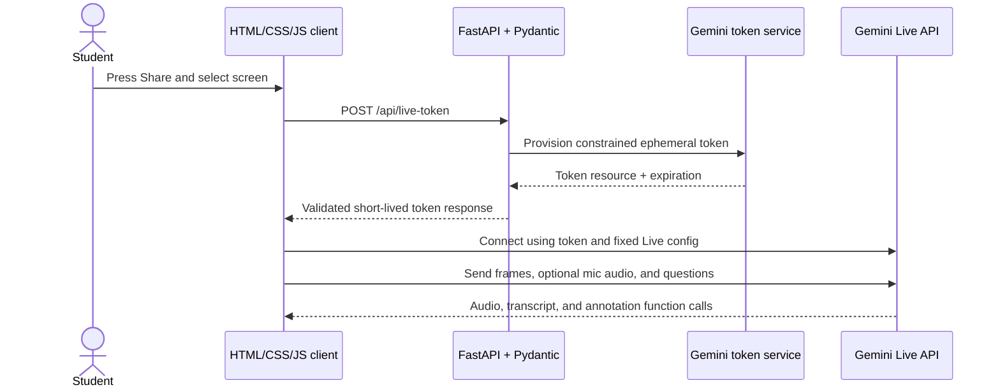

# Backend Design

**Project:** Screen Tutor  
**Status:** Design draft  
**Service:** Python and Pydantic

## Purpose and scope

The backend exists to protect the long-lived Gemini API key and issue short-lived Gemini Live credentials to the browser. The browser connects directly to the Gemini Live API so real-time screen and audio streams do not pass through or get stored by Screen Tutor's server.

For the MVP, the backend does not receive screen frames, microphone audio, tutor audio, transcripts, or annotation data. It does not proxy the Live WebSocket.

The backend also runs the **class library**: it stores each student's classes and uploaded course materials (notes, documents, syllabi, lecture slides, and video/audio lectures), extracts text and transcribes lectures with the Gemini API, and generates quizzes, practice tests, study guides, and flashcards from them. This part uses Supabase Auth for sign-in, Supabase PostgreSQL for application data and Auth sessions, and private file storage.

## Proposed backend stack

- Python 3.12+
- FastAPI for a small HTTP API and serving the built frontend on the same origin.
- Pydantic v2 for request, settings, and response validation.
- `pydantic-settings` for environment-based configuration, including local `.env` loading.
- Google's `google-genai` Python SDK to provision ephemeral Live API tokens.
- Uvicorn as the ASGI server.
- Supabase Auth and its managed PostgreSQL database. Supabase Auth owns login sessions; the app schema stores class-library data and refers to the Supabase Auth user ID for ownership. The initial schema is versioned in [the Supabase migration](../supabase/migrations/20261010120000_initial_class_library.sql); the FastAPI database connection and class-library endpoints will be added in a later implementation step.
- Private object storage for original uploaded files (local disk for a demo; S3-compatible or Supabase/Firebase storage for deployment).
- A background job runner for slow work such as lecture transcription and generation (FastAPI `BackgroundTasks` for the demo; a real queue such as RQ or Celery if needed later).
- File parsers: `pypdf` for PDFs, `python-docx` for DOCX, `python-pptx` for PPTX. Images, scanned PDFs, and video/audio go to Gemini.

### Supabase PostgreSQL schema

The initial migration covers Supabase Auth user ownership, classes, course notes/materials, generated quizzes and practice exams (as well as the other planned study-material types), source-note links, and completed attempts. Class `owner_id` references `auth.users(id)` directly with `ON DELETE CASCADE`; the app does not keep a duplicate user identity table. Foreign keys cascade class deletion through its notes, generated materials, and attempts. Composite class keys prevent source-note link rows from crossing class boundaries; backend validation must also keep citations inside the generated JSON content consistent with those links. Deleting a source note deletes generated materials derived from it. Original file bytes remain in private object storage; PostgreSQL holds the storage key, extracted text, lecture transcript segments, and parsed syllabus outline. Live screen/audio media, live-session transcripts, annotation events, and tutoring conversations are not stored.

### Supabase Auth sessions

Supabase Auth is the source of truth for browser sign-in sessions. It stores and manages those records in its protected `auth.sessions` table and issues a short-lived access-token JWT plus a rotating refresh token. Do not create a second `public.user_sessions` table, copy refresh tokens into application tables, or write directly to `auth.sessions`; use the Supabase Auth client/API for sign-in, refresh, and sign-out. The app schema only references the stable Supabase user UUID (`auth.users.id`) for ownership.

| Event | Session behavior |
| --- | --- |
| Sign-in | Supabase Auth creates the login session and returns access and refresh tokens to the browser Auth client. |
| API request | The browser sends the current access JWT to FastAPI; FastAPI verifies it and uses the verified `sub` UUID as the owner. |
| Token refresh | The Auth client exchanges the current refresh token for a new access/refresh pair; application tables are not involved. |
| Sign-out | The Auth client asks Supabase Auth to revoke the session and clears its local session state. An already-issued access JWT can remain valid until its `exp` claim. |

The browser uses the Supabase JavaScript Auth client to sign in and refresh its session. For every protected FastAPI request, it sends the current access token as `Authorization: Bearer <access-token>`. FastAPI verifies the JWT signature and validates its issuer, audience, expiration, and `sub` claim using the project's Supabase signing keys or a supported Supabase verifier. It treats the verified `sub` UUID as the caller identity; it never trusts a user ID sent in a request body or URL. The frontend's publishable key is safe for browser use; Supabase secret/service-role keys and the PostgreSQL connection string remain server-only.

The Supabase Auth project settings control access-token lifetime and supported session timeouts. Access tokens default to a one-hour lifetime; sessions otherwise remain active until sign-out or another configured termination event. Keep the default JWT lifetime unless deployment needs justify a change, and choose session timeout settings before public deployment. If a future high-risk operation requires immediate session revocation, additionally check the token's `session_id` against Supabase Auth session state for that operation; do not make every request depend on querying internal Auth tables.

Application tables have row-level security enabled with no browser-facing policies in the prototype. Class-library data is accessed through FastAPI, which verifies the caller and scopes every query by the verified owner UUID. Keep the database connection and any privileged Supabase key on the server. If the app later accesses application tables directly through Supabase's Data API, add and review user-scoped RLS policies before granting that access.

Keep schema changes in timestamped `supabase/migrations/` files and apply them through the Supabase CLI. Obtain `DATABASE_URL` from the Supabase project's Connect dialog and store it only on the server. A persistent backend can use the direct connection where its network supports IPv6 (or the project's IPv4 add-on); an IPv4-only backend can use the session pooler. Use the project's selected Postgres major version when configuring local Supabase development.

This login session is separate from a tutoring Live session. The browser owns the Gemini Live connection and any transient resume handle. Do not store Gemini ephemeral access tokens, Live session handles, media, transcripts, annotations, or tutoring conversations in Supabase Auth or the application tables.

The frontend can be plain HTML/CSS/JS bundled by Vite. In development, Vite proxies `/api` to FastAPI; in deployment, FastAPI serves the built static files or the host serves both behind one same-origin URL.

## Responsibilities

### Backend owns

- Load and validate `GEMINI_API_KEY` and the server-selected `GEMINI_MODEL`.
- Verify Supabase Auth access tokens and derive the caller's user ID from verified claims.
- Create ephemeral tokens with short session-start and token expiration windows.
- Lock token constraints to the approved Live model and the app's fixed session configuration/tool declarations where supported by the API.
- Apply request-size limits, origin checks, rate limits, and sanitized errors.
- Serve the frontend and a health endpoint, if the selected deployment uses a same-origin host.
- Supabase Auth sign-in/session management, and scoping every class, upload, and study material to the verified owner's Supabase user ID.
- Receiving course-material uploads, validating type and size, and storing the original file.
- Extracting text from documents and slides, transcribing video/audio lectures with timestamps, and parsing syllabi into a topic/exam outline.
- Generating quizzes, practice tests, study guides, and flashcards from a class's materials with a structured-output schema, and validating the result before saving it.
- Scoring quiz and practice-test attempts.
- Adding the selected class's materials (or a summary of them) to the Live session's system instructions when issuing a token for that class.

### Backend does not own

- Browser screen selection or media capture.
- Live audio/video forwarding, model response playback, or annotation rendering.
- General purpose model proxying, screenshot persistence, or Live conversation storage.
- Any tool that clicks, types, or controls the student's desktop.

## Request flow



The server token request occurs after the student begins the session. It is independent of the media stream. The browser sends media directly to Gemini and handles all Live events.

## HTTP API

### `POST /api/live-token`

Requires a valid Supabase access token in the `Authorization: Bearer <access-token>` header. No caller-controlled model or tool configuration is accepted. The request body is empty (or `{}`), or contains only an optional `class_id`, so the server always chooses the model and configuration. When `class_id` is given, the server checks that the verified Supabase user owns the class and builds the session's system instructions from that class's materials on the server side; the client cannot supply its own instructions.

**Success response**

```json
{
  "access_token": "ephemeral-token-value",
  "model": "gemini-3.8-live",
  "expires_at": "2026-10-10T18:30:00Z"
}
```

`access_token` is the short-lived token resource returned by Google's token provisioning API. It is a bearer credential: return it only to the requesting app session, never log it, persist it, or send it to analytics. The browser passes it to the Google GenAI JavaScript SDK for a Live API session.

**Pydantic contracts**

- `LiveTokenRequest`: optional `class_id` only; reject unexpected fields so callers cannot select a different model or expand tool access.
- `LiveTokenResponse`: required `access_token`, literal/configured `model`, and timezone-aware `expires_at`.
- `ErrorResponse`: stable error code and short user-safe message; never include upstream credentials or raw exception text.

**Status codes**

| Status | Meaning |
| --- | --- |
| `200` | Token issued |
| `400` | Malformed request |
| `401` | App authentication required or expired |
| `403` | Request origin or policy rejected |
| `429` | Token issuance rate limit reached |
| `503` | Server is missing Gemini configuration |
| `502` | Gemini token provisioning failed |

### Class library endpoints

All of these require a valid Supabase access token and only return the caller's own data. Responses use Pydantic models. FastAPI derives the owner ID from the verified JWT `sub` claim and applies that owner filter on every query; clients do not submit an authoritative owner ID.

| Method and path | Purpose |
| --- | --- |
| `GET /api/classes` · `POST /api/classes` | List or create classes |
| `PATCH /api/classes/{class_id}` · `DELETE /api/classes/{class_id}` | Rename or delete a class (delete removes its uploads, files, and study materials) |
| `POST /api/classes/{class_id}/uploads` | Multipart upload of one file (or pasted text) with an optional `kind`: `notes`, `document`, `syllabus`, `slides`, `lecture_video`, `lecture_audio`. Returns the upload with `status: processing` and starts a background job |
| `GET /api/classes/{class_id}/uploads` | List uploads with kind, status, and progress |
| `GET /api/uploads/{upload_id}` | Upload detail: extracted text, lecture transcript segments, and a short-lived signed URL for the original file |
| `PATCH /api/uploads/{upload_id}` · `DELETE /api/uploads/{upload_id}` | Rename, change kind, edit extracted text, or delete (removes file and text) |
| `GET /api/classes/{class_id}/syllabus` · `PUT …/syllabus` | Read or correct the parsed topic/exam outline |
| `POST /api/classes/{class_id}/study-materials` | Start generating a `quiz`, `practice_exam`, `study_guide`, or `flashcards` with a scope (all, upload IDs, syllabus topics, or an exam) and options. Returns `status: generating` |
| `GET /api/classes/{class_id}/study-materials` · `GET /api/study-materials/{id}` | List materials or fetch one (questions include source links: upload ID plus page, slide, or lecture timestamp) |
| `DELETE /api/study-materials/{id}` | Delete a material |
| `POST /api/study-materials/{id}/attempts` | Submit answers; the server scores them and returns the result with explanations |
| `POST /api/study-materials/{id}/flags` | Flag a question or card as wrong |

### Upload processing

| Kind | Processing |
| --- | --- |
| Notes / documents | Parse text directly (TXT/MD, DOCX, text-based PDF); send images, handwriting, and scanned PDFs to Gemini for text extraction |
| Syllabus | Extract text, then ask Gemini for a structured outline (topics, weeks, exams with dates and topics) and save it |
| Slides | Extract text per slide with `python-pptx`/`pypdf`; send image-heavy slides to Gemini |
| Video / audio lectures | Upload to the Gemini Files API, ask for a timestamped transcript, summary, and key topics (including what's written on the board or slides for video), then save segments |

Each job updates the upload's `status` (`processing → ready | failed`) and progress so the frontend can poll. Jobs must be safe to retry. Large lectures are the slowest and most expensive step, so transcribe each one once and reuse the transcript for every later generation and tutoring session.

Generation sends only the in-scope uploads' text to a standard (non-Live) Gemini model with a response schema per material type, then rejects output with missing answers, a bad structure, or sources outside the class. If a class's text is too large for one request, summarize or chunk it per upload first.

### `GET /healthz`

Returns only service health, for example `{"status":"ok"}`. It must not disclose environment variables, token status, or Gemini account details.

## Token provisioning policy

The backend creates ephemeral tokens through the Gemini API's Live token provisioning feature using the Google GenAI Python SDK. The token request should:

- Use `GEMINI_API_KEY` only on the server.
- Set `uses` to one for a new Live session and use short, explicit expiration values allowed by the API.
- Constrain the model to `GEMINI_MODEL` (default `gemini-3.8-live`).
- Constrain supported Live configuration to audio responses, output transcription, screen input, session resumption if enabled, and only the `add_annotations` function.
- Reject or ignore client attempts to provide a different model, arbitrary instructions, or additional tools.

Keep the token configuration in one server-side module so frontend and backend settings do not drift. The browser must send the matching setup configuration when it connects. Verify all constraint fields against the current [ephemeral token documentation](https://ai.google.dev/gemini-api/docs/live-api/ephemeral-tokens) during implementation.

## Configuration and secrets

Read these values from the process environment, with `pydantic-settings` loading the ignored local `.env` file during development:

| Variable | Required | Purpose |
| --- | --- | --- |
| `GEMINI_API_KEY` | Yes | Server-only credential for token provisioning |
| `GEMINI_MODEL` | No | Allowed Live model; defaults to `gemini-3.8-live` |
| `APP_ORIGINS` | Deployment-dependent | Allowed browser origins for API requests |
| `TOKEN_RATE_LIMIT` | No | Maximum token requests per identity/window |
| `GEMINI_TEXT_MODEL` | Yes, for the class library | Standard Gemini model for text extraction, transcription, and study-material generation |
| `SUPABASE_URL` | Yes | Supabase project URL; used to identify the Auth issuer and signing-key endpoint |
| `SUPABASE_PUBLISHABLE_KEY` | Yes, for the frontend | Public project key used by the browser Supabase Auth client; never treat it as a user identity |
| `DATABASE_URL` | Yes, for the class library | Server-only connection string for the Supabase PostgreSQL database |
| `STORAGE_BUCKET` / `STORAGE_DIR` | Yes, for the class library | Where original uploaded files are stored |
| `MAX_UPLOAD_MB` / `MAX_LECTURE_MINUTES` | No | Upload size and lecture length limits |

Do not put the Gemini API key in frontend config, rendered HTML, client-side environment variables, source maps, or API responses. Use the repository's `.env.example` as the local template. Production deployment should inject secrets through its secret manager.

## Security and abuse controls

- Serve over HTTPS and use same-origin frontend/API deployment where possible.
- Allow only configured origins. Do not use wildcard CORS with credentials.
- Require an authenticated app session for public deployments. For a private hackathon demo without accounts, use a short-lived demo gate and strict IP/token rate limits; an unrestricted public token endpoint can be abused to incur API costs.
- Verify Supabase JWT signatures and standard claims before using `sub`; decoding a JWT without signature verification is not authentication. Never accept the Supabase publishable key as proof of a signed-in user.
- Apply limits to request body size, token issuance frequency, and simultaneous sessions per user/session.
- Do not log authorization headers, ephemeral tokens, API keys, request bodies containing credentials, or media (the backend should not receive media).
- Return generic upstream failures to the browser; log only a request ID, status, and safe error category.
- If abuse controls need counters, use short-lived in-memory counters for a single instance or a shared rate-limit store for multiple instances. Never store screen or microphone media as part of rate limiting.
- Check ownership on every class, upload, and study-material request. Keep uploaded files in private storage and serve them only through short-lived signed URLs.
- Keep Supabase secret/service-role keys and database credentials on the backend. The prototype enables RLS without browser-facing policies; do not expose class tables through the Data API until owner-scoped policies are in place.
- Check uploads by content type and size, not only by file extension. Limit upload size, lecture length, uploads per class, and generation requests per student.
- Never log uploaded file contents, extracted text, or transcripts.

## Runtime behavior and errors

- Validate settings at startup; fail closed if the API key is missing rather than serving an endpoint that appears to work.
- Apply a short timeout to token provisioning and map upstream timeouts/errors to a `502` response.
- Keep token issuance idempotency unnecessary: retries may issue another short-lived token, so rate limits must account for retries.
- Do not try to recover Live WebSocket sessions on the backend. The browser owns session resumption, reconnect UI, media stop behavior, and transcript continuity.
- Keep structured logs free of secrets and student content.

## Backend acceptance criteria

- The frontend can request a constrained ephemeral token and connect to `gemini-3.8-live` without exposing the long-lived API key.
- Invalid requests cannot choose another model or add tools.
- Missing configuration, Google API failure, rate limiting, and origin rejection return stable, sanitized errors.
- Screen/audio streams never transit the backend and are never stored by it.
- Same-origin static frontend and API routes work over HTTPS in the deployed environment.
- A signed-in student can create classes and upload notes, documents, a syllabus, slides, and a video/audio lecture; each reaches `ready` with extracted text, an outline, or a timestamped transcript.
- The backend generates a valid quiz, practice test, study guide, and flashcard set from a class's uploads, with source links, and scores quiz/test attempts.
- A Live token issued for a class includes only that class's materials, and one student can never read another student's classes or files.
- Deleting an upload or class removes its file, text, and derived data.

## Official references

- [Gemini Live API getting started](https://ai.google.dev/gemini-api/docs/live-api/get-started-sdk)
- [Gemini Live API tools](https://ai.google.dev/gemini-api/docs/live-api/tools)
- [Ephemeral tokens](https://ai.google.dev/gemini-api/docs/live-api/ephemeral-tokens)
- [Live API session management](https://ai.google.dev/gemini-api/docs/live-api/session-management)
- [FastAPI](https://fastapi.tiangolo.com/)
- [Pydantic](https://docs.pydantic.dev/latest/)
- [Google Gen AI Python SDK](https://github.com/googleapis/python-genai)
- [Supabase Auth sessions](https://supabase.com/docs/guides/auth/sessions)
- [Supabase JWT verification](https://supabase.com/docs/guides/auth/jwts)
- [Supabase user data and `auth.users` references](https://supabase.com/docs/guides/auth/managing-user-data)
