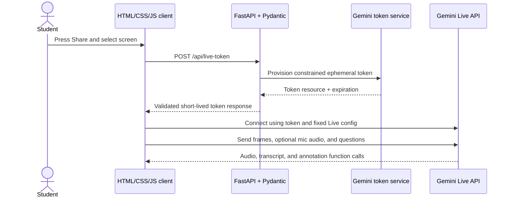

# Backend Design

**Project:** Screen Tutor  
**Status:** Design draft  
**Service:** Python and Pydantic

## Purpose and scope

The backend exists to protect the long-lived Gemini API key and issue short-lived Gemini Live credentials to the browser. The browser connects directly to the Gemini Live API so real-time screen and audio streams do not pass through or get stored by Screen Tutor's server.

For the MVP, the backend does not receive screen frames, microphone audio, tutor audio, transcripts, or annotation data. It does not proxy the Live WebSocket and does not need a database.

## Proposed backend stack

- Python 3.12+
- FastAPI for a small HTTP API and serving the built frontend on the same origin.
- Pydantic v2 for request, settings, and response validation.
- `pydantic-settings` for environment-based configuration, including local `.env` loading.
- Google's `google-genai` Python SDK to provision ephemeral Live API tokens.
- Uvicorn as the ASGI server.

The frontend can be plain HTML/CSS/JS bundled by Vite. In development, Vite proxies `/api` to FastAPI; in deployment, FastAPI serves the built static files or the host serves both behind one same-origin URL.

## Responsibilities

### Backend owns

- Load and validate `GEMINI_API_KEY` and the server-selected `GEMINI_MODEL`.
- Create ephemeral tokens with short session-start and token expiration windows.
- Lock token constraints to the approved Live model and the app's fixed session configuration/tool declarations where supported by the API.
- Apply request-size limits, origin checks, rate limits, and sanitized errors.
- Serve the frontend and a health endpoint, if the selected deployment uses a same-origin host.

### Backend does not own

- Browser screen selection or media capture.
- Live audio/video forwarding, model response playback, or annotation rendering.
- General purpose model proxying, user file uploads, screenshot persistence, or conversation storage.
- Any tool that clicks, types, or controls the student's desktop.

## Request flow



The server token request occurs after the student begins the session. It is independent of the media stream. The browser sends media directly to Gemini and handles all Live events.

## HTTP API

### `POST /api/live-token`

No caller-controlled model or tool configuration is accepted. The request body is empty (or `{}`) so the server always chooses the model and configuration.

**Success response**

```json
{
  "access_token": "ephemeral-token-value",
  "model": "gemini-3.8-live",
  "expires_at": "2026-10-10T18:30:00Z"
}
```

`access_token` is the short-lived token resource returned by Google's token provisioning API. It is a bearer credential: return it only to the requesting app session, never log it, persist it, or send it to analytics. The browser passes it to the Google GenAI JavaScript SDK for a Live API session.

**Pydantic contracts**

- `LiveTokenRequest`: empty model; reject unexpected fields so callers cannot select a different model or expand tool access.
- `LiveTokenResponse`: required `access_token`, literal/configured `model`, and timezone-aware `expires_at`.
- `ErrorResponse`: stable error code and short user-safe message; never include upstream credentials or raw exception text.

**Status codes**

| Status | Meaning |
| --- | --- |
| `200` | Token issued |
| `400` | Malformed request |
| `401` | App authentication required or expired |
| `403` | Request origin or policy rejected |
| `429` | Token issuance rate limit reached |
| `503` | Server is missing Gemini configuration |
| `502` | Gemini token provisioning failed |

### `GET /healthz`

Returns only service health, for example `{"status":"ok"}`. It must not disclose environment variables, token status, or Gemini account details.

## Token provisioning policy

The backend creates ephemeral tokens through the Gemini API's Live token provisioning feature using the Google GenAI Python SDK. The token request should:

- Use `GEMINI_API_KEY` only on the server.
- Set `uses` to one for a new Live session and use short, explicit expiration values allowed by the API.
- Constrain the model to `GEMINI_MODEL` (default `gemini-3.8-live`).
- Constrain supported Live configuration to audio responses, output transcription, screen input, session resumption if enabled, and only the `add_annotations` function.
- Reject or ignore client attempts to provide a different model, arbitrary instructions, or additional tools.

Keep the token configuration in one server-side module so frontend and backend settings do not drift. The browser must send the matching setup configuration when it connects. Verify all constraint fields against the current [ephemeral token documentation](https://ai.google.dev/gemini-api/docs/live-api/ephemeral-tokens) during implementation.

## Configuration and secrets

Read these values from the process environment, with `pydantic-settings` loading the ignored local `.env` file during development:

| Variable | Required | Purpose |
| --- | --- | --- |
| `GEMINI_API_KEY` | Yes | Server-only credential for token provisioning |
| `GEMINI_MODEL` | No | Allowed Live model; defaults to `gemini-3.8-live` |
| `APP_ORIGINS` | Deployment-dependent | Allowed browser origins for API requests |
| `TOKEN_RATE_LIMIT` | No | Maximum token requests per identity/window |

Do not put the Gemini API key in frontend config, rendered HTML, client-side environment variables, source maps, or API responses. Use the repository's `.env.example` as the local template. Production deployment should inject secrets through its secret manager.

## Security and abuse controls

- Serve over HTTPS and use same-origin frontend/API deployment where possible.
- Allow only configured origins. Do not use wildcard CORS with credentials.
- Require an authenticated app session for public deployments. For a private hackathon demo without accounts, use a short-lived demo gate and strict IP/token rate limits; an unrestricted public token endpoint can be abused to incur API costs.
- Apply limits to request body size, token issuance frequency, and simultaneous sessions per user/session.
- Do not log authorization headers, ephemeral tokens, API keys, request bodies containing credentials, or media (the backend should not receive media).
- Return generic upstream failures to the browser; log only a request ID, status, and safe error category.
- Use no database for the MVP. If abuse controls need counters, use short-lived in-memory counters for a single instance or a shared rate-limit store for multiple instances. Never store media as part of rate limiting.

## Runtime behavior and errors

- Validate settings at startup; fail closed if the API key is missing rather than serving an endpoint that appears to work.
- Apply a short timeout to token provisioning and map upstream timeouts/errors to a `502` response.
- Keep token issuance idempotency unnecessary: retries may issue another short-lived token, so rate limits must account for retries.
- Do not try to recover Live WebSocket sessions on the backend. The browser owns session resumption, reconnect UI, media stop behavior, and transcript continuity.
- Keep structured logs free of secrets and student content.

## Backend acceptance criteria

- The frontend can request a constrained ephemeral token and connect to `gemini-3.8-live` without exposing the long-lived API key.
- Invalid requests cannot choose another model or add tools.
- Missing configuration, Google API failure, rate limiting, and origin rejection return stable, sanitized errors.
- Screen/audio streams never transit the backend and are never stored by it.
- Same-origin static frontend and API routes work over HTTPS in the deployed environment.

## Official references

- [Gemini Live API getting started](https://ai.google.dev/gemini-api/docs/live-api/get-started-sdk)
- [Gemini Live API tools](https://ai.google.dev/gemini-api/docs/live-api/tools)
- [Ephemeral tokens](https://ai.google.dev/gemini-api/docs/live-api/ephemeral-tokens)
- [Live API session management](https://ai.google.dev/gemini-api/docs/live-api/session-management)
- [FastAPI](https://fastapi.tiangolo.com/)
- [Pydantic](https://docs.pydantic.dev/latest/)
- [Google Gen AI Python SDK](https://github.com/googleapis/python-genai)
