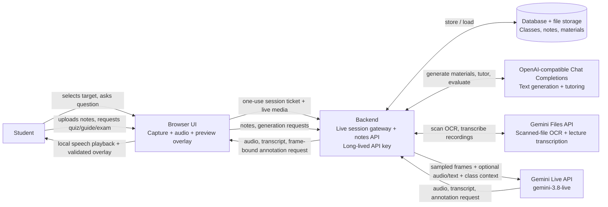

# Screen Tutor — Product and Technical Design

**Project:** HackRU Fall 2026  
**Status:** Design draft  
**Working name:** Screen Tutor

Implementation detail lives in the [frontend design](frontend-design.md) and [backend design](backend-design.md).

The [proactive coaching and barge-in design](proactive-coaching-design.md) describes the implemented backend for automatic spoken hints while the student works silently, including scheduling, interruptions, privacy, verification evidence, and the frontend handoff.

## Summary

Screen Tutor is an AI tutor that runs in a browser and observes a screen the student explicitly shares. The student asks a question by voice or text. The tutor responds conversationally, refers to visible content, and can place a small number of temporary marks—such as a pointer, underline, or note—over the relevant region in the web app's live preview.

The browser owns screen capture and drawing. Gemini interprets the shared frames and returns speech, text transcription, and structured annotation requests. The web app validates those requests and draws the marks locally over its preview. It never gives the model general mouse, keyboard, shell, or application-control access. Study-material text generation uses the administrator-configured OpenAI-compatible Chat Completions route; Gemini remains in use for Live tutoring and file/media workflows without a shared Chat Completions upload protocol.

Students can also upload their own course materials (notes, documents, syllabi, lecture slides, and recorded video or audio lectures) and organize them by class (for example, Math, Biology, or History). Each class has its own tutor context: when the student studies in a class, the tutor grounds its answers in that class's materials, and it can generate quizzes, study guides, practice exams, and flashcards from them.

**Scope note:** a regular web page can show annotations over the shared-screen preview inside that page. It cannot draw a persistent overlay over another desktop application. The MVP keeps the preview visible beside the conversation so the student can see the marks in context.

## Goals

- Let a student get help about the work currently visible on their display.
- Keep explanations conversational and anchored to what the tutor can actually see.
- Make it easy to point at a particular equation, line of code, diagram, or UI element.
- Keep the student in control of screen and microphone sharing, annotations, and session lifetime.
- Make the first useful interaction short: share, ask, understand, continue working.
- Let students upload their own notes, documents, syllabi, lecture slides, and video/audio lectures, and organize them by class.
- Generate study materials (quizzes, study guides, practice exams, flashcards) from a class's uploaded materials.
- Give each class a tutor that uses that class's notes as context, so answers match what the student is actually learning.
- Build revision-pinned retrieval and a source-backed concept map, then use them for private, evidence-based practice and progress views.

## Non-goals for the MVP

- Editing the student's document, code, or application for them.
- Clicking, typing, scrolling, or running commands on the student's behalf.
- Recording a lesson or retaining screenshots, audio, raw Live transcripts, or tutoring conversations. Assessment-derived responses, XP, and private mastery estimates are in scope; they are not inferred from Live media or exposed to teachers or classmates. (See [Privacy and data handling](#privacy-and-data-handling).)
- Shared classes support multiple members, temporary invitations, per-member capabilities, private study materials, shared contributions, publication schedules, and owner-private attempts. Class forking, leaderboards, and organization hierarchies are deferred. See [Shared classes design](shared-classes-design.md).
- Teacher dashboards or assignment grading.
- Guaranteeing perfect OCR or pixel-precise visual grounding. The student can correct or dismiss a mark.

## Primary user flow

1. **Start a session.** The student opens Screen Tutor and clicks Share. The browser's screen-sharing picker lets them choose a display, application window, or browser tab. The page shows the captured preview and requests microphone permission separately.
2. **Check sharing.** A persistent indicator shows that screen and/or microphone input is live. The student can pause either stream or end the session at any time.
3. **Ask for help.** The student asks aloud or types a question, such as “Why does this step follow?” or “Can you give me a hint for this error?”
4. **Get a grounded response.** Gemini sees recent sampled frames and the student's question. The tutor answers in voice, with a visible transcript or concise response card.
5. **See a mark when useful.** The tutor can request a local pointer, underline, box, or note linked to the current shared frame. The page positions it over the preview and shows a matching short explanation.
6. **Continue or clear.** Marks expire after a short time or can be dismissed individually. The student can ask a follow-up, pause sharing, or end the session.

### Notes and study flow

1. **Create a class.** The student creates a class such as “Math 151” or “Biology” from the Classes page.
2. **Upload course materials.** The student uploads notes, documents, a syllabus, lecture slides, a recorded video/audio lecture, or an existing test into that class, or pastes text. The app extracts text (and transcribes lectures) and shows each upload's processing status. A blank test is kept as a reference; a completed test is graded from an answer key when present, or against class notes with an estimated-grade label when no key is available.
3. **Study with the class tutor.** When the student starts a tutoring session inside a class, the tutor gets that class's notes as reference material (all of them, or the uploads the student picks), alongside any shared screen. Instead of sharing a screen, the student can open one of the class's uploads on the stage; the tutor sees and can mark up that page.
4. **Generate study materials.** The student picks a class (and optionally specific uploads, including existing tests, lectures, or syllabus topics) and asks for a quiz, study guide, practice exam, or flashcard set. The app generates it from those sources, saves it separately from the original uploads, and opens it.
5. **Practice and review.** The student takes a quiz or practice exam in the app, sees a score, and can open an inline text tutor on a missed question for hints and follow-up explanations while keeping the results visible.

Remote quizzes also offer an optional **Reasoning Mode** at start; Standard mode remains the default and keeps its existing answer-and-submit flow. In Reasoning Mode, students can select answers first, then explain their thinking. A backend sufficiency check unlocks submission for meaningful attempts even when they are wrong; a targeted follow-up or an explicit confirmed skip handles insufficient attempts. The selected mode belongs to that saved quiz run, and submitted reasoning receives separate post-grade feedback.

## Product behavior

### Tutor style

- Adapt support to the current learning obstacle: start with a hint when the student can take a next step, explain a missing prerequisite directly, and switch to a small analogous worked example after repeated unsuccessful hints. Fade help as the student progresses. Keep automatic screen checks brief and mistake-only.
- Withhold final answers and nontrivial step answers, even when directly requested. A routine intermediate step may be supplied only relative to the student's demonstrated level and when it is not the learning target. Reserve direct nontrivial answers for clearly communicated severe overwhelm after simpler help has failed; provide the minimum needed to resume learning. Confirming the student's own proposed answer is allowed.
- Explain what is visible and name uncertainty when text or layout is unclear.
- Treat newer screen frames and the student's corrections as updates. Do not describe erased or replaced work as still present, or keep flagging a step that has been corrected. Ask for the current step when uncertain.
- Keep spoken turns brief and let the student interrupt.
- Use marks sparingly; each one should clarify a spoken explanation.
- When the student explicitly asks for a mark on a clearly visible target, place it rather than only describing it.
- If a location cannot be identified confidently, describe it (“the second line under the graph”) or ask the student instead of inventing a precise mark.
- Optional **Check my steps** mode checks the shared screen automatically and speaks a short corrective hint when it identifies a clear mistake, without requiring a question or microphone input. It also follows spoken walkthroughs, waiting for a pause before feedback. Use available class notes, allow time for a correction, and stay quiet for correct, incomplete, or unclear work during automatic checks. Feedback can miss errors; interruption during uninterrupted speech is not guaranteed.

### Session controls

- Let the browser's source picker offer available displays, windows, and tabs; do not start sharing silently.
- Show a visible, persistent capture state and the selected target.
- Provide separate pause/resume controls for screen and microphone input, plus an obvious end-session action.
- Show when annotations are active. Let the student dismiss one mark or clear all marks.
- On disconnect or permission loss, stop sending media and explain how to resume.
- Select Check my steps before starting. End the session to change modes; microphone access is still enabled separately.
- Keep tutoring preferences and saved recap controls in Tutor settings, opened from the stage toolbar, so they do not consume the conversation history area.
- Provide Restart conversation to discard the current conversation and marks and skip saved recaps while retaining the authorized shared-screen preview. It starts a fresh tutor connection and leaves the microphone off until enabled again. Clear saved recaps separately deletes persisted memory.

### Notes and study materials

**Classes.** A class has one owner and may have additional members. Owners retain administrative control; members receive explicit capabilities through an invitation and can leave. Class resources have separate ownership and publication state. Students can create private study materials from class resources they can read without class-wide create permission. Personal materials survive membership removal and are visible only to their owner. Shared student contributions start as drafts and retain creator attribution. Deleting a class remains owner-only and deletes class-owned resources after confirmation; personal study materials are independent of the source class.

**Course materials.** In this doc, “notes” means any material the student uploads to a class. Each upload has a kind:

| Kind | Example inputs | How it's processed |
| --- | --- | --- |
| Notes | Typed notes, photos/scans of handwritten notes, pasted text | Text parsing; Gemini for images and handwriting |
| Documents | PDF, DOCX, TXT/Markdown readings, handouts, homework sheets | Text parsing; Gemini for scanned PDFs |
| Existing tests | Blank or completed test PDFs, documents, or scans | Preserve the original and extract questions. Keep blank tests as references; grade completed tests using a provided answer key or, without one, class notes and an estimated-grade label |
| Syllabus | Course syllabus (PDF/DOCX/text) | Text extraction plus a structured outline of topics, weeks, and exam dates |
| Lecture slides | PDF or PPTX slide decks | Per-slide text extraction; Gemini for image-heavy slides |
| Lecture video/audio | MP4/WebM/MOV video or MP3/M4A/WAV audio of a recorded lecture | Gemini transcription with timestamps, plus a summary and key-topic list; video frames used for board/slide content |

The app keeps the original file and the extracted text or transcript. The student can view, rename, change the kind of, edit the extracted text of, or delete any upload. Lecture recordings show a timestamped transcript, and study materials built from a lecture link back to the moment they came from. Parsed existing tests remain linked as sources for future practice assessments; generated assessments are stored separately so their questions, answer keys, and attempt scores remain stable.

**Syllabus as a study map.** When a class has a syllabus, the app shows its topic and exam outline. The student can generate materials scoped to a syllabus topic or an upcoming exam (for example, “practice exam for Midterm 1”), using only the uploads that cover those topics.

**Per-class tutor.** A tutoring session started inside a class includes that class's notes as reference context. The tutor should:

- Prefer the student's notes for definitions, notation, and methods, so explanations match the course.
- Say which note an explanation comes from when it relies on one.
- Say when the notes don't cover something rather than presenting outside knowledge as if it came from the notes.
- Keep classes separate: a Math session doesn't use Biology notes.

**Upload study documents.** Keep the full original uploaded file and extracted text intact. Each processed upload also gets a separate study explanation, with concise, balanced, and detailed versions. Students can switch between the original file, original text, and explanation, and download a saved PDF or LaTeX document. Companion PDFs include the full extracted source text in a separate appendix. AI explanations preserve source facts and identify uncertainty; the original file remains available for checking visual details and extraction errors.

**Generated study materials.** Materials are generated only from selected source material in the current class, such as notes or uploaded tests (or a chosen subset). Study guides persist as both structured content and downloadable LaTeX/PDF files for future reference:

| Type | Contents | Options |
| --- | --- | --- |
| Quiz | Short set of multiple-choice, true/false, and short-answer questions with an answer key and explanations | Number of questions, topics, difficulty |
| Study guide | Organized summary of key concepts, definitions, formulas, and examples | Topics, length |
| Practice exam | Longer, timed mix of question types (including worked/free-response problems) with a scoring rubric | Length, time limit, topics, difficulty |
| Flashcards | Term/definition or question/answer cards | Number of cards, topics |

Each question or section links back to the upload it was drawn from (page or slide number, or lecture timestamp). Students can keep generated materials private or explicitly create a class contribution. A student with read access can generate personal quizzes and exams without class-wide create permission. Quizzes and practice exams accept optional additional instructions for topics, difficulty, or question style. Those preferences are lower-trust than source grounding and required output rules, are stored privately for reproducibility, and have no effect when omitted. Unsupported requested topics are not invented and should be identified in generated explanations or exam instructions. Generated content can be wrong, so the UI labels it as AI-generated and lets the student flag an incorrect question.

Editing or deleting a source upload preserves saved study sets, downloadable guide files, and attempt history. The app marks changed or missing sources so the student knows when to regenerate. Large selected sources share a bounded excerpt budget, and partial coverage is disclosed. Removing a class member immediately revokes class access; personal materials remain private to their owner. Deleting a whole class remains an owner action and removes its class-scoped resources.

### Shared classes

Class membership and resource access are enforced by the backend on every request. Invitation codes are temporary, usage-limited, stored as digests, and redeemed atomically. Capabilities are independent: `edit` and `delete` apply to a member's own contributions, while a separate `delete_others` grant can remove another member's published contribution. Class-owned resources and class deletion remain owner-controlled. Drafts and future scheduled releases are filtered from student-facing resource APIs, generation, files, and tutor context. Answer keys have their own release state, and assessment attempts and reasoning traces remain scoped to the submitting user. Legacy attempts without reliable attribution remain unassigned and private. See [Shared classes design](shared-classes-design.md) for the schema and migration details. Forking, leaderboards, and organization hierarchies are deferred.

### Source-grounded learning and private mastery

Course uploads are indexed as a hierarchy of material, section, and chunk. Each logical source has a stable identity, while every processed edit creates an immutable content revision with a SHA-256 digest, extraction provenance, and page, slide, paragraph, or lecture-time locator where available. Search uses bounded, authorized SQLite FTS5/BM25 retrieval; a topic request does not load every lecture into model context. Citations point to the exact source revision used, and generated visual descriptions are labeled separately from extracted source text.

Each class can have a source-backed concept graph. Concepts and typed relationships retain their provenance and review state; inferred teaching order or similarity alone never establishes an essential prerequisite. Authorized class managers review proposed concepts and edges. Only validated prerequisite edges inform practice recommendations.

Generated assessments and reusable questions are versioned and source-linked. The server keeps answer specifications, option mappings, and grading rubrics private until the assessment's feedback-release policy permits disclosure. Students receive safe question projections and each has independent attempts. Standard quizzes and optional Reasoning Mode remain available. Mastery Ladder is a separate assessment mode: it progresses independently for each selected concept through four cognitive-demand levels, with a distinct same-level recovery question after a miss. A reasoning-required ladder evaluates reasoning quality separately from the existing sufficiency-to-submit gate.

Assessment outcomes create private, append-only evidence and idempotent XP events. XP measures participation, accuracy measures observed answer performance, and mastery estimates current concept proficiency; these measures are never substituted for one another. A deterministic, versioned Beta-Binomial-inspired projection reports uncertainty and evidence sufficiency. First-release mastery values are estimates, not empirically calibrated scores. Students can view their own XP, accuracy, concept estimates, history, growth, due reviews, and explainable practice recommendations. Class managers can review shared source-backed concepts and calibration flags, but cannot view individual student responses, reasoning, XP, mastery, or recommendations. Historical attempts without reliable ownership remain private and do not become evidence.

## System design



### Components

**Browser client**

- Calls `navigator.mediaDevices.getDisplayMedia()` directly from the student's Share button handler. The browser presents its own source picker and permission UI; the app must not try to choose or silently retain a source on the student's behalf.
- Displays the returned `MediaStream` in a video preview. Draws annotations in a positioned canvas/SVG layer aligned to that preview, so the geometry maps to the captured frame even when the preview is resized.
- Samples and scales frames before sending them. The Live API documents video frames as individual images at up to 1 frame per second; the client should send only as often as needed for the current tutoring exchange.
- Captures microphone audio only while enabled and plays the tutor's audio response.
- Renders transcripts, response cards, and annotations in the page. Annotation rendering is local and never modifies the captured app or desktop.
- Converts annotation coordinates from the referenced capture frame into preview coordinates, accounting for scaling, letterboxing, cropping, and source changes.

**Live session gateway**

- Holds provider credentials and owns model selection, system instructions, class context, and tool execution. Text generation uses the administrator-configured OpenAI-compatible route; Live voice remains Gemini.
- Issues a short-lived, one-use WebSocket ticket after origin, access, rate-limit, and optional class-membership checks. Removing a member revokes unused tickets and closes active class-context sessions. The ticket is not a provider credential and cannot be used to call the provider directly.
- Receives sampled frames, enabled microphone audio, and typed questions over the browser's same-origin WebSocket, then forwards them in memory to the Live API.
- Streams audio, transcripts, and frame-bound annotation requests back to the browser. It does not record or persist live media or raw conversation data; only explicitly enabled derived session recaps persist.
- For a public deployment, apply rate limits and abuse controls to ticket issuance and active WebSocket sessions.

**Notes and study backend**

- Scopes notes to the logged-in account in SQLite.
- Stores uploaded files in private object storage and stores classes, extracted note text, and generated materials in a database.
- Extracts text from uploads: direct parsing for text, DOCX, PPTX, and text-based PDFs; the configured compatible route describes inline slide images; Gemini Files processes images and scanned PDFs.
- Transcribes video/audio lectures with Gemini in a background job (upload to the Gemini Files API, request a timestamped transcript and summary), since long recordings can take minutes to process.
- Parses a syllabus into a structured outline (topics, weeks, exam dates) used to scope generation.
- Generates study materials, question-bank items, reasoning evaluations, and quiz-review tutor replies through the administrator-configured OpenAI-compatible Chat Completions route. The backend validates structured output before saving it. When saved recaps are explicitly enabled, the in-memory live-session transcript is also sent to this route for summarization. The route's base URL, model, and key are held server-side; the admin UI never reads a saved key back.
- When a Live session starts inside a class, supplies that class's note text (or a summary if the notes are too large) for the session's system context.
- Enforces upload limits (file size, files per class) and rate limits on generation.

**Data model (sketch)**

```text
Class          { id, owner_id, name, created_at }
Note           { id, class_id, title, kind: notes|document|syllabus|slides|lecture_video|lecture_audio,
                 file_url?, mime_type, duration_s?, extracted_text, transcript_segments[]? ({start_s, end_s, text}),
                 status: uploading|processing|ready|failed, created_at }
SyllabusOutline{ class_id, note_id, topics[] ({title, week?}), exams[] ({name, date?, topics[]}) }
StudyMaterial  { id, class_id, type: quiz|study_guide|practice_exam|flashcards, source_note_ids[], scope (topics/exam), options, content (JSON), created_at }
QuizRun        { id, material_id, owner_id, mode: standard|reasoning, status, score, created_at, completed_at }
Attempt        { id, material_id, answers, score, completed_at } // legacy standard score history
QuestionAttempt { id, quiz_run_id, question_id, state, reasoning_turns[], accepted_snapshot, submitted_snapshot, final_answer, grade, feedback }
```

The hackathon build stores application data in SQLite. Accounts (username or email plus password) and login sessions are handled by the backend itself, with no external account provider. Deployments deny guest access and close new account requests by default. Operators can independently enable guest pages, immediate public signup, or administrator-reviewed account requests in configuration; class libraries always require an account.

**Generated material format (quiz example)**

```json
{
  "type": "quiz",
  "title": "Derivatives: Chain Rule",
  "questions": [
    {
      "id": "q1",
      "kind": "multiple_choice",
      "prompt": "What is d/dx of sin(3x)?",
      "choices": ["cos(3x)", "3cos(3x)", "-3cos(3x)", "3sin(3x)"],
      "answer": 1,
      "explanation": "Chain rule: the derivative of the outer function, cos(3x), times the derivative of the inner function, 3.",
      "sources": [{ "note_id": "note-42", "page": 3 }, { "note_id": "lecture-7", "timestamp_s": 1265 }]
    }
  ]
}
```

The backend rejects output that doesn't match the schema, is missing answers, or cites notes outside the selected class.

**Gemini Live session**

- Uses `gemini-3.8-live` for low-latency multimodal conversation.
- Receives screen frames as image/video input, along with the student's audio or typed question.
- Returns audio for spoken tutoring. Enable output transcription when the app needs text captions or response cards; the Live model's primary response modality is audio.
- May call the app's narrow `add_annotations` function to request visual marks. The backend binds the request to the question or review's pinned frame and owns the provider tool response; the browser validates geometry, frame freshness, and current target content before rendering.

### Gemini Live integration

The current server-side model identifier is **`gemini-3.8-live`**. The Live API uses a persistent WebSocket session. Its documentation describes individual video frames sent as images at a maximum of 1 FPS, supports function calling, and provides output transcription for displaying generated speech as text.

The browser connects only to the backend's provider-neutral WebSocket protocol. The backend uses the long-lived API key and opens the provider session with fixed model, settings, system instructions, and tool declarations. No provider SDK, model identifier, prompt, tool schema, or provider credential is shipped in the browser bundle.

Live sessions have finite connection and media-session lifetimes. The implementation should handle disconnects, use session resumption/context compression where appropriate, and present a clear reconnect state rather than silently starting a fresh conversation. Keep a small local conversation summary for recovery only if needed; do not persist captured frames by default.

Official references:

- [Gemini 3.8 Live model page](https://ai.google.dev/gemini-api/docs/models/gemini-3.8-live)
- [Live API getting started](https://ai.google.dev/gemini-api/docs/live-api/get-started-sdk)
- [Live API capabilities and limits](https://ai.google.dev/gemini-api/docs/live-api/capabilities)
- [Live API tool use](https://ai.google.dev/gemini-api/docs/live-api/tools)
- [Live API session management](https://ai.google.dev/gemini-api/docs/live-api/session-management)
- [Google Gen AI Python SDK](https://googleapis.github.io/python-genai/)
- [MDN: Screen Capture API and `getDisplayMedia()`](https://developer.mozilla.org/en-US/docs/Web/API/MediaDevices/getDisplayMedia)

### Annotation contract

Expose one visual tool to the model, for example:

```json
{
  "name": "add_annotations",
  "arguments": {
    "items": [
      {
        "kind": "underline",
        "region": { "x": 0.12, "y": 0.34, "width": 0.48, "height": 0.06 },
        "label": "Check the sign in this step"
      }
    ]
  }
}
```

The backend attaches the frame ID pinned to the question or automatic review when it sends an annotation request to the browser. It never rebinds coordinates to a later frame. Coordinates are normalized to that exact frame (`0..1`, origin at top-left), with width and height as extents rather than end coordinates. The browser rejects malformed values, unknown or stale frame IDs, excessive annotation counts, regions outside the capture bounds, and targets that no longer match the preview. Annotations are short-lived, non-interactive, and removable. If geometry is missing or invalid, show the verbal explanation without drawing.

The tool should have no capability beyond adding or clearing this overlay. In particular, do not expose general desktop-control tools.

## Saved session memory

Approved on 2026-10-11: signed-in students may enable saved tutoring recaps separately for each class or general tutoring. Memory starts off. Explicitly ending a session saves a short recap of topics, observed progress, practice targets, and the next unfinished step; recent recaps inform future sessions. Students can view and clear saved recaps. Full conversations, raw transcripts, screenshots, and microphone audio remain temporary. No learner diagnosis or automatic mastery profile is created. Unexpected disconnects do not save in this first version.

## Privacy and data handling

- Screen sharing starts only after a click and the browser's source-selection/permission flow. The browser requires a fresh user action for each capture request; use HTTPS outside localhost. Microphone permission is requested separately.
- The selected screen content and optional microphone stream pass through the Screen Tutor backend and are forwarded to Google's Gemini API for the live session. Tell the student this before they start sharing.
- Do not save screenshots, audio, or transcripts by default. Keep frame buffers in memory only and clear them when sharing stops or the session ends.
- Keep all provider credentials and model configuration on the backend. Session tickets grant only access to the same-origin WebSocket, expire quickly, and can be consumed once.
- Pause immediately when the student pauses capture, the browser reports the track ended, permission is revoked, or the session ends. A change of source requires a new browser selection flow.
- Avoid sending unchanged frames repeatedly. Provide a clear screen pause control for sensitive content.
- Uploaded notes and generated study materials **are** stored, because the student explicitly saves them. They are scoped to the student's account, and the student can delete any note, material, or whole class. Deleting a note removes the file and its extracted text.
- Revisioned source chunks, class concept/edge provenance, immutable assessment snapshots, the student's intentionally submitted assessment responses and reasoning, XP events, evidence, private mastery projections, and recommendations may be stored to provide the learning features described above. Every read rechecks current ownership, class membership, capabilities, publication/release state, and attempt ownership. Assessment-derived progress belongs to the student and is never visible to classmates or class managers; legacy outcomes with unknown owners are excluded. Deletion, membership removal, and resource release changes must not leave retrievable chunks or recommendation links that bypass current access checks.
- The browser receives only safe question projections before feedback release. Answer keys, randomized option mappings, rubrics, and grading instructions stay on the backend. A provider outage leaves completed and saved assessments readable; pending grading does not count as an incorrect answer or mastery evidence.
- Uploaded course content and relevant study requests are sent to the administrator-configured AI provider for text generation/tutoring; scanned-file OCR and lecture recordings still use Gemini Files. Tell students which provider their deployment uses before upload, and remind them to upload only recordings they are allowed to keep (some courses restrict lecture recordings).

## MVP acceptance criteria

- A student can explicitly choose a screen/window/tab through the browser, see its live preview, and start and stop sharing.
- A student can ask one spoken or typed question about visible content and receive a relevant spoken answer.
- The app can show the answer as readable text when transcription is enabled.
- The tutor can return at least one frame-grounded annotation, and the overlay places it in the correct region of the selected target's preview.
- The student can dismiss marks and pause screen and microphone input independently.
- The app handles permission denial, network loss, invalid annotation data, and Live session expiry without crashing or continuing to send media.
- The shipped client contains no long-lived Gemini API key, and the default flow stores no captured media.
- A student can create at least two classes (for example, Math and Science), upload notes into each, and see them kept separate.
- A student can generate a quiz and a study guide from a class's notes, take the quiz in the app, and see a score with explanations.
- Classes and saved course materials persist in the configured SQLite database and private upload directory.
- A tutoring session started in a class uses that class's notes and not another class's.
- A student can delete a note or class, and it no longer appears or affects generation.

## Risks and mitigations

| Risk                                                        | Mitigation                                                                                                                                                                        |
| ----------------------------------------------------------- | --------------------------------------------------------------------------------------------------------------------------------------------------------------------------------- |
| Model points to the wrong line or object                    | Anchor marks to a specific sent frame, keep marks temporary, and let the student dismiss them. When uncertain, answer in words instead.                                           |
| Screen sharing exposes unrelated private content            | Let the student choose a window/display, show a persistent indicator, and provide immediate pause/end controls.                                                                   |
| Live API latency or disconnect interrupts tutoring          | Use concise turns, expose connection state, and implement session resumption/recovery.                                                                                            |
| Live media traverses the backend                           | Keep active-session buffers in memory only, apply strict size/rate limits, and never log or persist media or transcripts.                                                        |
| Frequent frames increase cost and context usage             | Respect the documented frame-rate limit, sample only when needed, and avoid resending unchanged content.                                                                          |
| Screen-capture support and behavior vary by browser         | Prototype on the target desktop browser early, detect unavailable capture APIs, and offer a clear error with transcript-only fallback.                                            |
| Generated questions or answers are wrong                    | Generate only from the student's notes, cite the source note, validate the schema, label content as AI-generated, and let the student flag errors.                                |
| A class has too many notes to fit in context                | Summarize or chunk notes per class, and let the student pick specific notes or topics for each generation.                                                                        |
| Poor text extraction from handwritten or low-quality photos | Show the extracted text for review and let the student edit it or re-upload.                                                                                                      |
| Long lecture videos are slow or costly to process           | Process in a background job with visible progress, cap video length and size, transcribe once and reuse the transcript, and let the student upload audio-only instead.            |
| Stored notes leak between local workspaces                  | Scope every query by owner UUID and keep files in private storage behind signed URLs.                                                                                             |
| A student expects marks to appear over the external app     | Keep the preview and annotations visible together, and state that marks are in the web UI. A system-wide overlay would require a separate native client and is outside MVP scope. |

## Open implementation decisions

- First supported browser(s) and screen-capture compatibility target.
- Whether the MVP uses voice by default or starts with typed questions plus optional voice.
- Annotation appearance and expiration time.
- Whether students can opt into storing session summaries later.
- Supported upload formats and size limits for the MVP, including maximum lecture video length and whether to keep the original video or only its transcript after processing.
- Whether notes reach the tutor as full text, summaries, or chunks retrieved per question (RAG).
- Which OpenAI-compatible route and model the administrator configures for text generation.
- The file-storage provider and deployment configuration (private S3-compatible storage or local private storage).
- Whether a future public deployment needs a dedicated account provider.
