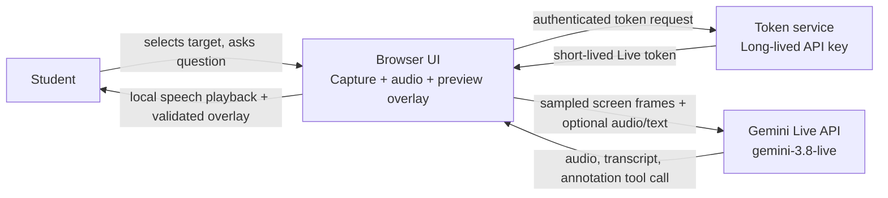

# Screen Tutor — Product and Technical Design

**Project:** HackRU Fall 2026  
**Status:** Design draft  
**Working name:** Screen Tutor

## Summary

Screen Tutor is an AI tutor that runs in a browser and observes a screen the student explicitly shares. The student asks a question by voice or text. The tutor responds conversationally, refers to visible content, and can place a small number of temporary marks—such as a pointer, underline, or note—over the relevant region in the web app's live preview.

The browser owns screen capture and drawing. Gemini interprets the shared frames and returns speech, text transcription, and structured annotation requests. The web app validates those requests and draws the marks locally over its preview. It never gives the model general mouse, keyboard, shell, or application-control access.

**Scope note:** a regular web page can show annotations over the shared-screen preview inside that page. It cannot draw a persistent overlay over another desktop application. The MVP keeps the preview visible beside the conversation so the student can see the marks in context.

## Goals

- Let a student get help about the work currently visible on their display.
- Keep explanations conversational and anchored to what the tutor can actually see.
- Make it easy to point at a particular equation, line of code, diagram, or UI element.
- Keep the student in control of screen and microphone sharing, annotations, and session lifetime.
- Make the first useful interaction short: share, ask, understand, continue working.

## Non-goals for the MVP

- Editing the student's document, code, or application for them.
- Clicking, typing, scrolling, or running commands on the student's behalf.
- Recording a lesson, retaining screenshots, or building student profiles.
- Supporting multiple students, classrooms, teacher dashboards, or assignment grading.
- Guaranteeing perfect OCR or pixel-precise visual grounding. The student can correct or dismiss a mark.

## Primary user flow

1. **Start a session.** The student opens Screen Tutor and clicks Share. The browser's screen-sharing picker lets them choose a display, application window, or browser tab. The page shows the captured preview and requests microphone permission separately.
2. **Check sharing.** A persistent indicator shows that screen and/or microphone input is live. The student can pause either stream or end the session at any time.
3. **Ask for help.** The student asks aloud or types a question, such as “Why does this step follow?” or “Can you give me a hint for this error?”
4. **Get a grounded response.** Gemini sees recent sampled frames and the student's question. The tutor answers in voice, with a visible transcript or concise response card.
5. **See a mark when useful.** The tutor can request a local pointer, underline, box, or note linked to the current shared frame. The page positions it over the preview and shows a matching short explanation.
6. **Continue or clear.** Marks expire after a short time or can be dismissed individually. The student can ask a follow-up, pause sharing, or end the session.

## Product behavior

### Tutor style

- Start with a hint or a clarifying question instead of immediately solving the whole problem.
- Explain what is visible and name uncertainty when text or layout is unclear.
- Keep spoken turns brief and let the student interrupt.
- Use marks sparingly; each one should clarify a spoken explanation.
- If a location cannot be identified confidently, describe it (“the second line under the graph”) or ask the student instead of inventing a precise mark.

### Session controls

- Let the browser's source picker offer available displays, windows, and tabs; do not start sharing silently.
- Show a visible, persistent capture state and the selected target.
- Provide separate pause/resume controls for screen and microphone input, plus an obvious end-session action.
- Show when annotations are active. Let the student dismiss one mark or clear all marks.
- On disconnect or permission loss, stop sending media and explain how to resume.

## System design



### Components

**Browser client**

- Calls `navigator.mediaDevices.getDisplayMedia()` directly from the student's Share button handler. The browser presents its own source picker and permission UI; the app must not try to choose or silently retain a source on the student's behalf.
- Displays the returned `MediaStream` in a video preview. Draws annotations in a positioned canvas/SVG layer aligned to that preview, so the geometry maps to the captured frame even when the preview is resized.
- Samples and scales frames before sending them. The Live API documents video frames as individual images at up to 1 frame per second; the client should send only as often as needed for the current tutoring exchange.
- Captures microphone audio only while enabled and plays the tutor's audio response.
- Renders transcripts, response cards, and annotations in the page. Annotation rendering is local and never modifies the captured app or desktop.
- Converts annotation coordinates from the referenced capture frame into preview coordinates, accounting for scaling, letterboxing, cropping, and source changes.

**Token service**

- Holds the long-lived Gemini API key.
- Authenticates the client and provisions a short-lived, restricted Live API token for the selected model/configuration.
- Does not receive or proxy screen frames or microphone audio in the proposed client-to-Gemini design.
- For a public deployment, apply rate limits and abuse controls to token issuance.

**Gemini Live session**

- Uses `gemini-3.8-live` for low-latency multimodal conversation.
- Receives screen frames as image/video input, along with the student's audio or typed question.
- Returns audio for spoken tutoring. Enable output transcription when the app needs text captions or response cards; the Live model's primary response modality is audio.
- May call the app's narrow `add_annotations` function to request visual marks. The app must execute and validate function calls itself and return a tool response to the Live session.

### Gemini Live integration

The current model identifier is **`gemini-3.8-live`**. The Live API uses a persistent WebSocket session. Its documentation describes individual video frames sent as images at a maximum of 1 FPS, supports function calling, and provides output transcription for displaying generated speech as text.

For a browser client that connects directly to Gemini, the token service should issue an ephemeral token. Do not bundle a long-lived API key in client JavaScript. Configure the token to constrain the model and allowed session settings. Keep the system instructions and tool declaration fixed on the trusted side where supported.

Live sessions have finite connection and media-session lifetimes. The implementation should handle disconnects, use session resumption/context compression where appropriate, and present a clear reconnect state rather than silently starting a fresh conversation. Keep a small local conversation summary for recovery only if needed; do not persist captured frames by default.

Official references:

- [Gemini 3.8 Live model page](https://ai.google.dev/gemini-api/docs/models/gemini-3.8-live)
- [Live API getting started](https://ai.google.dev/gemini-api/docs/live-api/get-started-sdk)
- [Live API capabilities and limits](https://ai.google.dev/gemini-api/docs/live-api/capabilities)
- [Live API tool use](https://ai.google.dev/gemini-api/docs/live-api/tools)
- [Ephemeral tokens](https://ai.google.dev/gemini-api/docs/live-api/ephemeral-tokens)
- [Live API session management](https://ai.google.dev/gemini-api/docs/live-api/session-management)
- [MDN: Screen Capture API and `getDisplayMedia()`](https://developer.mozilla.org/en-US/docs/Web/API/MediaDevices/getDisplayMedia)

### Annotation contract

Expose one visual tool to the model, for example:

```json
{
  "name": "add_annotations",
  "arguments": {
    "frame_id": "frame-123",
    "items": [
      {
        "kind": "underline",
        "region": { "x": 0.12, "y": 0.34, "width": 0.48, "height": 0.06 },
        "label": "Check the sign in this step"
      }
    ]
  }
}
```

Coordinates are normalized to the exact frame that was sent (`0..1`, origin at top-left). The client should reject malformed values, unknown or stale frame IDs, excessive annotation counts, and regions outside the capture bounds. Annotations should be short-lived, non-interactive, and removable. If geometry is missing or invalid, show the verbal explanation without drawing.

The tool should have no capability beyond adding or clearing this overlay. In particular, do not expose general desktop-control tools.

## Privacy and data handling

- Screen sharing starts only after a click and the browser's source-selection/permission flow. The browser requires a fresh user action for each capture request; use HTTPS outside localhost. Microphone permission is requested separately.
- The selected screen content and optional microphone stream are sent to Google's Gemini API for the live session. Tell the student this before they start sharing.
- Do not save screenshots, audio, or transcripts by default. Keep frame buffers in memory only and clear them when sharing stops or the session ends.
- Keep the Gemini API key on the token service. Use short-lived ephemeral tokens in the client.
- Pause immediately when the student pauses capture, the browser reports the track ended, permission is revoked, or the session ends. A change of source requires a new browser selection flow.
- Avoid sending unchanged frames repeatedly. Provide a clear screen pause control for sensitive content.

## MVP acceptance criteria

- A student can explicitly choose a screen/window/tab through the browser, see its live preview, and start and stop sharing.
- A student can ask one spoken or typed question about visible content and receive a relevant spoken answer.
- The app can show the answer as readable text when transcription is enabled.
- The tutor can return at least one frame-grounded annotation, and the overlay places it in the correct region of the selected target's preview.
- The student can dismiss marks and pause screen and microphone input independently.
- The app handles permission denial, network loss, invalid annotation data, and Live session expiry without crashing or continuing to send media.
- The shipped client contains no long-lived Gemini API key, and the default flow stores no captured media.

## Risks and mitigations

| Risk | Mitigation |
| --- | --- |
| Model points to the wrong line or object | Anchor marks to a specific sent frame, keep marks temporary, and let the student dismiss them. When uncertain, answer in words instead. |
| Screen sharing exposes unrelated private content | Let the student choose a window/display, show a persistent indicator, and provide immediate pause/end controls. |
| Live API latency or disconnect interrupts tutoring | Use concise turns, expose connection state, and implement session resumption/recovery. |
| Exposed client API key | Use a backend-issued ephemeral token constrained to the Live model and session configuration. |
| Frequent frames increase cost and context usage | Respect the documented frame-rate limit, sample only when needed, and avoid resending unchanged content. |
| Screen-capture support and behavior vary by browser | Prototype on the target desktop browser early, detect unavailable capture APIs, and offer a clear error with transcript-only fallback. |
| A student expects marks to appear over the external app | Keep the preview and annotations visible together, and state that marks are in the web UI. A system-wide overlay would require a separate native client and is outside MVP scope. |

## Open implementation decisions

- First supported browser(s) and screen-capture compatibility target.
- Whether the MVP uses voice by default or starts with typed questions plus optional voice.
- Annotation appearance and expiration time.
- Whether students can opt into storing notes or session summaries later.
- Authentication approach for a public demo versus a local hackathon build.
